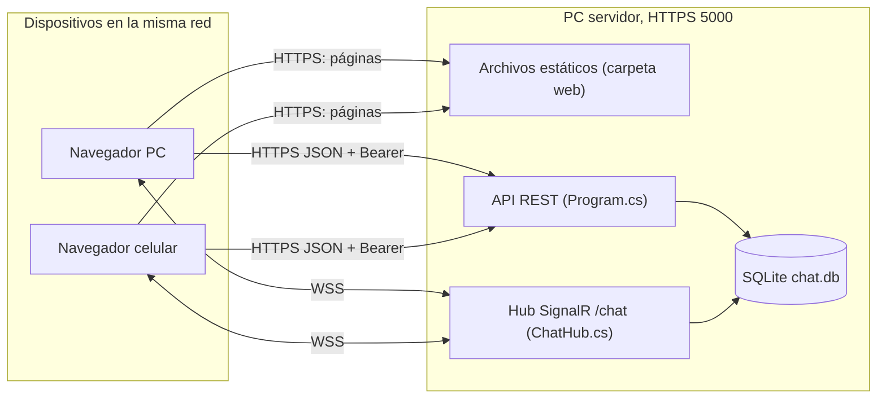
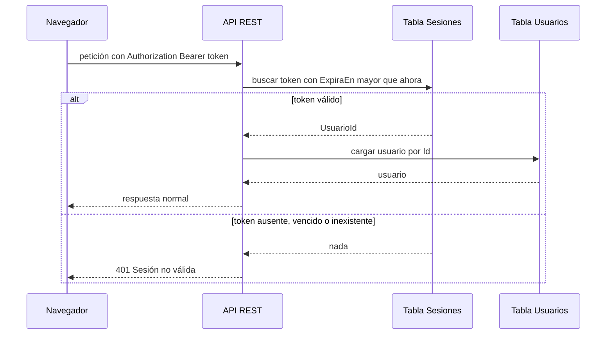
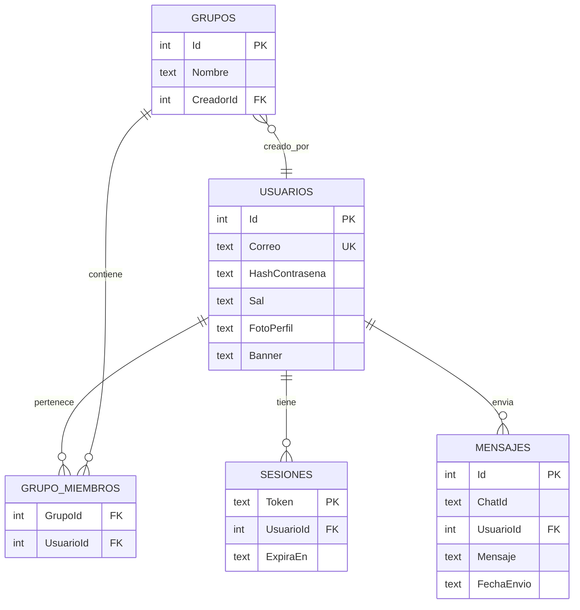
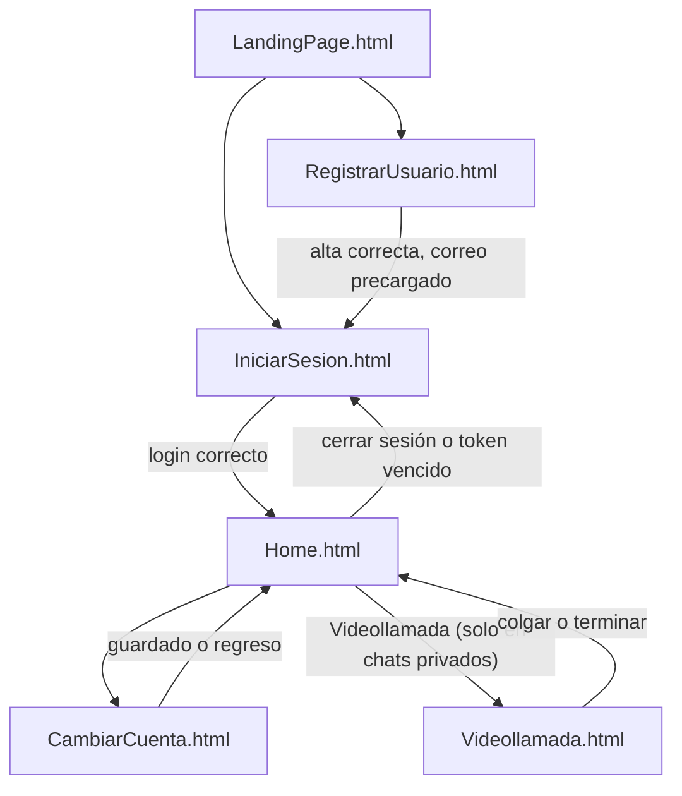

# Music Hub: documentación técnica

Proyecto integrador de aprendizaje (PIA), primer avance. Es una aplicación web de chat en tiempo real con cuentas de usuario, mensajes privados, grupos y perfiles. Corre en una PC y se usa desde navegadores de varios dispositivos conectados a la misma red local.

Este documento describe el proyecto tal como está en la rama `2da-Rama`. Cuando algo no está implementado, se indica.

## Índice

1. [Alcance y estado por pantalla](#1-alcance-y-estado-por-pantalla)
2. [Arquitectura](#2-arquitectura)
3. [Tecnologías](#3-tecnologías)
4. [Estructura de carpetas](#4-estructura-de-carpetas)
5. [Backend en detalle (`server/ChatServer`)](#5-backend-en-detalle-serverchatserver)
6. [Base de datos](#6-base-de-datos)
7. [Seguridad](#7-seguridad)
8. [Referencia de la API REST](#8-referencia-de-la-api-rest)
9. [Referencia del hub SignalR](#9-referencia-del-hub-signalr)
10. [Frontend (`web/`)](#10-frontend-web)
11. [Ejecución y uso entre varios dispositivos](#11-ejecución-y-uso-entre-varios-dispositivos)
12. [Pruebas](#12-pruebas)
13. [Decisiones de diseño](#13-decisiones-de-diseño)
14. [Limitaciones y pendientes](#14-limitaciones-y-pendientes)
15. [Discrepancias detectadas](#15-discrepancias-detectadas)
16. [Glosario](#16-glosario)

---

## 1. Alcance y estado por pantalla

El enunciado pide siete pantallas. Esta es la situación actual:

| # | Pantalla | Estado | Qué hay | Qué falta |
|---|---|---|---|---|
| 1 | Registro e inicio de sesión | Parcial | Alta de cuenta con correo, login por correo. Al abrir `Home.html` se conecta al servidor de forma automática. | Tras registrarse no inicia sesión automáticamente: envía al login con el correo precargado. |
| 2 | Panel principal y lista de chats | Parcial | Sin canales fijos: mensajes privados con último mensaje, grupos con botón +, estado en línea en la lista y en el encabezado. | Alerta de mensajes nuevos por chat (no existe). |
| 3 | Chat privado 1 a 1 | Parcial | Texto en tiempo real, historial persistido, botón de videollamada, interruptor de cifrado extremo a extremo por chat (opcional) y ubicación compartida con mapa de OpenStreetMap. | Archivos (texto, imagen, audio). La ubicación se bloquea mientras el cifrado esté activo. |
| 4 | Videollamada 1 a 1 | Hecho | WebRTC real con cámara y micrófono entre los dos integrantes de un chat privado. Aviso de llamada entrante, contestar/rechazar, silenciar micrófono, apagar cámara y colgar. Señalización por el hub. | Solo dentro de la misma red local (sin STUN/TURN). No se probó con dos navegadores reales. Sin compartir pantalla ni llamadas de grupo. |
| 5 | Creación y chat grupal | Hecho en servidor e interfaz | Crear grupo (mínimo 3 integrantes contando al creador), chat grupal con texto y ubicación, agregar y quitar integrantes, salir del grupo. | La interfaz de grupos no se ha probado en un navegador real. |
| 6 | Gestión de tareas | Hecho en servidor e interfaz | Solo se sincronizan cuando el grupo tiene enlace de recompensas. Con enlace hay 3 retos predefinidos por integrante y grupo: mensaje, archivo y ubicación. La interfaz busca la evidencia en el historial del chat, valida que sea del usuario y del tipo correctos, y finaliza el reto. Persisten en SQLite y se actualizan en vivo con SignalR. | La interfaz de tareas no se ha probado en un navegador real. |
| 7 | Recompensas | Hecho en servidor e interfaz | 18 photocards locales. El enlace es opcional al crear el grupo y puede habilitarse después; sin enlace no hay retos ni canje. Con enlace, el creador elige 3 cartas, al completar los 3 retos se entregan 2 cartas del plan y el token `/r/...` entrega la tercera. Cualquier usuario autenticado puede ver la colección de otro desde el panel del grupo; el panel derecho muestra nombre y `@usuario`, sin correo ni fotos, y ofrece volver al perfil propio. | La galería no se ha probado en un navegador real. |

Pruebas automatizadas del backend: cuenta (26 casos), grupos (57 casos), tareas y recompensas (45 casos), persistencia del historial (17 casos), borrado local de chats (25 casos), ubicación compartida (26 casos), archivos (38 casos), correo (29 casos), señalización de videollamadas (30 casos) y cifrado (35 casos de servidor + 17 del módulo de WebCrypto). Ver la sección [12](#12-pruebas).

---

## 2. Arquitectura

El sistema tiene tres partes que corren en la misma PC: un servidor ASP.NET Core que atiende la API, el hub de tiempo real y los archivos estáticos; una base SQLite en un solo archivo; y el frontend, que son páginas HTML con JavaScript que se ejecutan en el navegador de cada dispositivo.



Hay un solo proceso del servidor y un solo archivo de base de datos vivo (`data/chat.db`). El chat, la presencia y el historial no usan servicios externos; las imágenes de perfil viajan dentro de la base como texto (data URL). Los archivos adjuntos sí se guardan en Cloudinary (sección 8.4) y necesitan su configuración en `appsettings.Development.json`. La copia de `chat.db` dentro de `bin/` es un respaldo de la ubicación anterior y no se usa.

### Flujo de una sesión

1. El usuario abre `Home.html` o `IniciarSesion.html` en el navegador.
2. Si no hay sesión guardada, `Home.js` redirige al login.
3. El login llama a `POST /api/login`, que devuelve un token. El token se guarda en `sessionStorage`.
4. Con el token, `Home.js` abre la conexión SignalR a `/chat`. Al abrir un chat se une a él; al inicio no hay ninguno seleccionado.
5. Cada petición a la API lleva `Authorization: Bearer <token>`. El servidor resuelve al usuario a partir del token; no confía en datos que mande el cliente sobre su identidad.

### Autenticación de cada petición



---

## 3. Tecnologías

### Backend (`server/ChatServer`)

| Elemento | Versión o detalle |
|---|---|
| Lenguaje y framework | C# con .NET 8 (`net8.0`). `RollForward` en `Major` porque la máquina tiene el SDK de .NET 10. |
| Tipo de proyecto | `Microsoft.NET.Sdk.Web` (incluye ASP.NET Core y SignalR, no hay paquete NuGet aparte para SignalR). |
| Opciones del compilador | `Nullable` habilitado, `ImplicitUsings` habilitado. |
| Acceso a datos | `Microsoft.Data.Sqlite` 8.0.10 (ADO.NET directo, sin Entity Framework). |
| Estilo de API | Minimal API: los endpoints se declaran en `Program.cs` con `app.MapGet`, `MapPost`, `MapPatch` y `MapDelete`. |
| Tiempo real | SignalR (hub `ChatHub`). |
| Puerto | HTTPS en `0.0.0.0:5000` (Kestrel con `certs/servidor.pfx` y `ListenAnyIP`). |

### Frontend (`web/`)

| Elemento | Detalle |
|---|---|
| Lenguaje | HTML5, CSS3 y JavaScript vanilla (sin framework ni empaquetador). |
| Cliente SignalR | `web/libs/signalr.min.js`, versión 8.0.29, incluido en el repositorio. |
| Almacenamiento en el navegador | `sessionStorage` para la sesión (una por pestaña). Las tareas y recompensas viven en SQLite, no en el navegador. |
| Fuentes de datos | API REST en `https://<host>:5000` y hub SignalR (WSS) en `/chat`. La URL se calcula con `window.location.hostname`. |

### Herramientas de prueba

- PowerShell 5.1 para las pruebas HTTP y del hub (`pruebas/*.ps1`).
- Las pruebas del hub hablan el protocolo JSON de SignalR sobre `ClientWebSocket`, sin paquetes NuGet adicionales ni Node.

### Lo que no se usa

- `client/` contiene un experimento anterior en React y Vite. No está versionado (`.gitignore`) y no forma parte del producto.

---

## 4. Estructura de carpetas

```
PIA/
├── README.md                    Portada del proyecto y cómo correrlo
├── docs/
│   └── DOCUMENTACION.md         Este documento
├── dotnet-tools.json            Manifiesto de smtp4dev para la prueba de correo
├── Photocards/                  Imágenes originales entregadas (fuente)
├── server/
│   └── ChatServer/
│       ├── ChatServer.csproj    Proyecto .NET 8 y dependencia de SQLite
│       ├── Program.cs           Arranque, HTTPS, middleware, API REST y avisos de grupos
│       ├── CertificadoHttps.cs  Ubica servidor.pfx (PIA_CERTIFICADO o certs/)
│       ├── RutaDatos.cs         Ubica chat.db (PIA_CARPETA_DATOS o data/)
│       ├── appsettings*.json    Logging, SMTP y Cloudinary (Development manda en dotnet run)
│       ├── Properties/
│       │   └── launchSettings.json   Perfil de arranque para Visual Studio
│       ├── Hubs/
│       │   └── ChatHub.cs       Hub SignalR: conexión, grupos, mensajes y llamadas
│       ├── Llamadas/
│       │   └── LlamadasServicio.cs  Estado y reglas de las videollamadas 1 a 1
│       ├── UsuariosBd.cs        Tabla Usuarios, hash de contraseñas, perfil e imágenes
│       ├── SesionesBd.cs        Tabla Sesiones: tokens con caducidad
│       ├── MensajesBd.cs        Tabla Mensajes, BorradosChat, chatId y control de acceso
│       ├── GruposBd.cs          Tablas Grupos, GrupoMiembros y enlaces por grupo
│       ├── TareasBd.cs          Catálogo de 3 retos, backfill por grupo y verificación
│       ├── RecompensasBd.cs     Catálogo de 18 photocards, planes por grupo y tokens
│       ├── LimiteIntentos.cs    Contador en memoria de intentos fallidos de login
│       ├── CorreoServicio.cs    Envío SMTP desde el chat privado
│       ├── usuario.cs           Modelo Usuario
│       ├── mensaje.cs           Modelo Mensaje
│       ├── conversacion.cs      Modelo de resumen de conversación privada
│       ├── tarea.cs             Modelo Tarea
│       ├── recompensa.cs        Modelo Recompensa
│       ├── pruebas/
│       │   ├── prueba_cuenta.ps1   26 casos: cuenta, sesiones, login, imágenes
│       │   ├── prueba_grupos.ps1   57 casos: grupos y membresía
│       │   ├── prueba_tareas_recompensas.ps1   45 casos: retos verificados, enlace opcional, plan de cartas, barra lateral y colección
│       │   ├── prueba_persistencia.ps1   17 casos: historial tras cerrar sesión y reiniciar
│       │   ├── prueba_llamada.ps1   30 casos: señalización de videollamadas por el hub
│       │   ├── prueba_cifrado.ps1   35 casos: contrato del cifrado en el servidor
│       │   ├── prueba_borrado_chat.ps1   25 casos: borrado local de DMs y grupos
│       │   ├── prueba_ubicacion.ps1   26 casos: ubicación compartida en DMs y grupos
│       │   └── prueba_cifrado_cliente.mjs   17 casos: web/cifrado.js real en Node
│       ├── tools/
│       │   └── generar_certificados.ps1   CA local y certificado HTTPS del servidor
│       ├── certs/              Certificados generados (ignorado por Git)
│       └── data/               chat.db en ejecución (ignorado por Git)
└── web/
    ├── LandingPage.html / .css  Portada pública con enlace a iniciar sesión
    ├── RegistrarUsuario.html    Formulario de alta
    ├── IniciarSesion.html       Formulario de login
    ├── Formularios.css          Estilos de login y registro
    ├── ValidacionRegistro.js    Validación de formularios y llamadas de login y registro
    ├── Home.html / .css / .js   Aplicación principal: chats, grupos, perfil, tareas, cartas
    ├── CambiarCuenta.html / .css / .js   Edición de perfil, contraseña y fotos
    ├── Videollamada.html / .css / .js    Llamada 1 a 1 con WebRTC (video remoto, video propio y controles)
    ├── cartas.js                 Catálogo local de 18 photocards
    ├── fotocards/                1.png … 18.png, servidas por el backend
    └── libs/
        └── signalr.min.js       Cliente SignalR 8.0.29
```

Las carpetas `bin/`, `obj/` y `.vs/` son generadas por el compilador y el IDE. `chat.db` vive en `server/ChatServer/data/`, fuera de `bin/`, para que un `clean` o un rebuild no borren el historial. La carpeta se crea al arrancar y está en `.gitignore`. La primera vez que arranca, si existe un `chat.db` en `bin/Debug/net8.0/`, se copia a `data/` (el original se conserva como respaldo; no lo edites).

`Photocards/` es la carpeta original entregada con las 18 imágenes. El servidor solo sirve archivos desde `web/`, así que las copias que se usan en la aplicación son `web/fotocards/1.png` … `18.png`. Ambas carpetas están sin versionar; no se movió ni borró ninguna.

`dotnet-tools.json` está en la raíz porque `prueba_correo.ps1` lo pasa explícitamente con `dotnet tool restore --tool-manifest $manifiesto`. .NET no lo encontraría automáticamente: si se restaura a mano, hay que usar `dotnet tool restore --tool-manifest dotnet-tools.json` desde la raíz.

---

## 5. Backend en detalle (`server/ChatServer`)

### 5.1 Arranque (`Program.cs`)

El orden de inicialización es el siguiente:

1. `WebApplication.CreateBuilder` y Kestrel con `ListenAnyIP(5000, UseHttps(...))`. `CertificadoHttps.Ruta()` resuelve `PIA_CERTIFICADO` o `certs/servidor.pfx`.
2. Registro de CORS con la política `SignalR`: cualquier origen, método y cabecera (necesario para probar desde otros dispositivos).
3. `AddSignalR()` con JSON que conserva los nombres de C#, y registro de `CorreoServicio` y `LlamadasServicio` como singletons.
4. Opciones de JSON de la API: `PropertyNamingPolicy = null`. Las respuestas salen con los nombres de C# (`Nombre`, `Correo`, `Mensajes`), no en camelCase, porque el frontend los usa así.
5. `app.Build()` y `SesionesBd.LimpiarVencidas()`: borra sesiones vencidas y las anteriores a la caducidad al arrancar.
6. `UseCors`.
7. Middleware de caché: responde `Cache-Control: no-store` a todo, excepto `/chat`. Evita que el navegador o el celular muestren HTML o JS viejos durante el desarrollo.
8. `UseDefaultFiles` y `UseStaticFiles` con un `PhysicalFileProvider` sobre la carpeta `web/`. `Home.html` es la página por defecto.
9. `MapHub<ChatHub>("/chat")`.
10. Definición de los endpoints de la API.

La carpeta `web/` se localiza subiendo desde el directorio de contenido o desde el binario hasta encontrar `web/Home.html`. Solo se expone `web/`. La carpeta del proyecto no se sirve, así que `chat.db`, `bin/` y `.vs/` no son accesibles por HTTP.

### 5.2 Funciones auxiliares de `Program.cs`

| Función | Qué hace |
|---|---|
| `TokenDe(contexto)` | Lee el token del encabezado `Authorization: Bearer`. |
| `UsuarioAutenticado(contexto)` | Token, luego `SesionesBd.ObtenerUsuarioId`, luego `UsuariosBd.BuscarPorId`. Devuelve `null` si algo falla. |
| `SinSesion()` | Respuesta `401` con mensaje en español. |
| `ValidarContrasena(texto)` | Mínimo 8 y máximo 128 caracteres, con mayúscula, número y símbolo. |
| `ValidarImagen(dataUrl, etiqueta)` | Solo JPEG, PNG o WebP en base64 válido, de como máximo 700 000 caracteres. |
| `AvisarGrupoActualizado(hub, grupoId)` | Envía `GrupoActualizado` a todas las conexiones de los integrantes. |
| `AvisarTareaActualizada(hub, grupoId)` | Envía `TareaActualizada` con el `chatId` del grupo a los integrantes. |
| `AvisarRecompensa(hub, usuarioId, recompensa)` | Envía `RecompensaOtorgada` al usuario que finalizó la tarea. |
| `SacarDelGrupo(hub, usuarioId, grupoId)` | Quita al usuario del grupo SignalR en todas sus conexiones y envía `QuitadoDeGrupo`. |

### 5.3 Capa de datos

Cada clase de datos es estática, abre una conexión por operación y crea sus tablas en el constructor estático. Las migraciones son `ALTER TABLE ... ADD COLUMN` cuando falta una columna (se detecta con `PRAGMA table_info`).

| Clase | Responsabilidad |
|---|---|
| `UsuariosBd` | Alta, búsqueda por correo o id, listado de contactos, actualización de cuenta en una transacción, hash PBKDF2. |
| `SesionesBd` | Crear token, validar con caducidad, eliminar, limpiar vencidas. |
| `MensajesBd` | Guardar y leer mensajes y ubicaciones por `chatId`, conversaciones privadas, reglas de acceso a cada tipo de chat. |
| `GruposBd` | Crear grupo con creador e integrantes, consultar membresía, agregar y quitar integrantes con traspaso de creador, guardar el enlace del grupo. |
| `TareasBd` | Sincronizar 3 retos predefinidos por integrante y grupo, listarlos, verificar la evidencia y finalizar solo el asignado. |
| `RecompensasBd` | Catálogo de 18 photocards, plan de 3 cartas por grupo, tokens de canje y colección por usuario con origen y grupo. |
| `LimiteIntentos` | Contador en memoria por correo para el límite de login. |

### 5.4 Tipos de chat y reglas de acceso

El campo `chatId` identifica cada conversación. Hay tres formas:

| Forma | Ejemplo | Quién puede leer y escribir |
|---|---|---|
| Canal público | cualquier texto; la interfaz ya no ofrece canales fijos | Cualquier usuario autenticado. La barra lateral solo muestra chats privados y grupos. |
| Chat privado | `dm:3:7` (ids ordenados, menor primero) | Solo los dos participantes. |
| Grupo | `grupo:12` | Solo los integrantes actuales del grupo. |

Reglas de validación:

- Un `dm:` que no sea canónico (por ejemplo `DM:1:2`, `dm:2:1` o `dm:1:1`) se rechaza para todos.
- Un `grupo:` que no sea canónico (por ejemplo `grupo:012` o `grupo:0`) se rechaza para todos.
- La membresía de un grupo se consulta en cada operación, así que quien sale pierde acceso de inmediato.

### 5.5 Mensajes

- `SendToGroup` guarda el mensaje antes de enviarlo. Si el guardado falla, el cliente no recibe nada.
- `SendToGroupCifrado` hace lo mismo, pero recibe además el IV, la clave pública ECDH del emisor y la clave pública del destinatario usada para cifrar. El servidor nunca deriva ni conoce la clave AES: solo valida el formato y guarda el texto cifrado, el IV y ambas claves públicas.
- `SendToGroupUbicacion` guarda una ubicación estructurada: `Mensaje` queda vacío, `Tipo = 'ubicacion'` y las coordenadas y la etiqueta van en `Latitud`, `Longitud` y `Etiqueta`. Valida acceso al chat, latitud en `[-90, 90]`, longitud en `[-180, 180]` y etiqueta de hasta 120 caracteres (vacía se normaliza a «Mi ubicación»). El evento `ReceiveUbicacion` nunca contiene las coordenadas como texto plano del mensaje.
- La ubicación no se cifra. El cliente deshabilita el botón cuando el E2EE está activo en ese DM, para no enviar coordenadas en claro dentro de un chat cifrado.
- El cifrado solo se acepta en un `dm:` canónico. En canales públicos y en grupos, `SendToGroupCifrado` lanza `HubException`. También se rechaza un IV que no sea base64 de 12 bytes, una clave de emisor o destinatario que no sea SPKI P-256, una clave de destinatario ausente o un texto cifrado de más de 20 000 caracteres.
- La fecha se guarda en UTC (`DateTime.UtcNow`) con formato ISO 8601. Al mostrarla, `ToLocalTime()` la convierte a la hora de la PC servidor.
- El historial devuelve los últimos mensajes en orden cronológico. Si no se indica `limite`, son 30; un valor mayor que 50 se recorta a 50, y uno menor que 1 vuelve a 30.
- Leer el historial de un grupo no exige ser integrante actual: quien salió o fue quitado también puede leerlo (ver la tabla `GrupoExintegrantes`). El hub sigue exigiendo membresía actual para unirse y para enviar.

### 5.6 Hub SignalR (`Hubs/ChatHub.cs`)

- `OnConnectedAsync` lee el token de `Authorization: Bearer` o del parámetro `access_token` (el navegador no puede poner cabeceras en el WebSocket). Si el token no es válido, llama a `Context.Abort()` y cierra la conexión.
- La identidad se guarda en `Context.Items` (id y nombre completo). El cliente no la envía.
- Cada conexión se registra en un diccionario estático `ConexionesPorUsuario`. Así la API puede sacar a un usuario de un grupo en todas sus pestañas.
- `OnDisconnectedAsync` elimina la conexión de ese diccionario. Si era la última del usuario, avisa a los demás y da un margen de 15 s antes de cerrar una videollamada en curso (por si la página se recarga o pasa de `Home` a `Videollamada`).
- `SendToGroup` usa `Clients.OthersInGroup`: el emisor no recibe eco, porque su navegador ya pinta el mensaje. Sus otras pestañas con la misma cuenta sí lo reciben.
- `SendToGroupCifrado` comparte la misma validación de acceso y añade las de cifrado (sección 5.5). El evento `ReceiveMessage` incluye al final `cifrado`, `iv`, `clavePublica` y `clavePublicaDestino`; en un mensaje normal van `false`, `null`, `null` y `null`.
- `SendToGroupUbicacion` comparte la validación de acceso, valida coordenadas y etiqueta, guarda el mensaje y emite `ReceiveUbicacion` a los demás integrantes. Es un método aparte para no alterar la firma de `SendToGroup`.

### 5.7 Videollamadas 1 a 1 (`Llamadas/LlamadasServicio.cs`)

El estado vive en memoria; no se guarda en SQLite.

- Solo se permiten en un `dm:`: el servidor comprueba que el llamante pertenece a esa conversación.
- Cada usuario puede estar en **una** llamada a la vez. No se puede llamar a alguien que ya está en otra ni a alguien desconectado.
- Roles: **llamante** (quien inicia) y **receptor**. El receptor recibe `LlamadaEntrante` y debe contestar antes de unirse; el llamante puede entrar a esperar de inmediato.
- Si nadie contesta en 30 s, la llamada termina con «sin respuesta».
- Al colgar, rechazar o perder la conexión, el servidor envía `LlamadaTerminada` con el motivo (`colgada`, `rechazada`, `sin respuesta` o `desconectado`).
- La señalización WebRTC (oferta, respuesta y candidatos ICE) viaja por un grupo SignalR propio (`llamada:{id}`) con `GroupExcept`, así las pestañas de `Home` no reciben SDP. Los mensajes de señal se limitan a 20 000 caracteres y a los tipos `listo`, `oferta`, `respuesta` y `candidato`.
- La página de la llamada se une con `UnirseLlamada`; si el receptor no ha contestado, el servidor lo rechaza.

### 5.8 Avisos en tiempo real

| Situación | Evento | Destinatario |
|---|---|---|
| Se envía un mensaje | `ReceiveMessage` | Integrantes del chat, sin el emisor |
| Se comparte una ubicación | `ReceiveUbicacion` | Integrantes del chat, sin el emisor |
| Cambia la lista de integrantes de un grupo | `GrupoActualizado` | Todos los integrantes actuales |
| Se crea o finaliza una tarea | `TareaActualizada` | Todos los integrantes actuales del grupo |
| Se otorga una recompensa | `RecompensaOtorgada` | El usuario que finalizó la tarea, en todas sus conexiones |
| El usuario sale o es quitado | `QuitadoDeGrupo` | Ese usuario, en todas sus conexiones |
| Alguien inicia una videollamada | `LlamadaEntrante` | El receptor, en todas sus conexiones |
| El receptor contesta | `LlamadaAceptada` | Ambos participantes |
| La llamada termina | `LlamadaTerminada` | Ambos participantes |
| Llega una señal WebRTC | `SenalLlamada` | El otro participante de la llamada |

Al quitar o salir, el servidor saca al usuario del grupo SignalR antes de enviar el aviso. Por eso, aunque la pestaña siga abierta, ya no recibe mensajes de ese grupo.

---

## 6. Base de datos

Archivo: `chat.db` (SQLite), en `server/ChatServer/data/`. Se crea solo al arrancar. Está en `.gitignore`. La ruta se resuelve en `RutaDatos.cs`; la variable de entorno `PIA_CARPETA_DATOS` la cambia (las pruebas la usan para aislar su base).

### Tabla `Usuarios`

| Columna | Tipo | Notas |
|---|---|---|
| `Id` | INTEGER PK | Autoincremental. |
| `Nombre`, `Apellido` | TEXT NOT NULL | |
| `Usuario` | TEXT NOT NULL | Nombre de usuario visible. Puede repetirse. |
| `Correo` | TEXT NOT NULL UNIQUE | Los correos nuevos se guardan en minúsculas (registro y cambio de perfil). El login y las comprobaciones de duplicado no distinguen mayúsculas. |
| `HashContrasena`, `Sal` | TEXT NOT NULL | PBKDF2 en Base64. |
| `FechaRegistro` | TEXT NOT NULL | ISO 8601, UTC. |
| `FotoPerfil`, `Banner` | TEXT NULL | Data URL de la imagen. Migración automática. |
| `ClavePublica` | TEXT NULL | Clave pública ECDH P-256 del último dispositivo que abrió el chat (SPKI en base64). El servidor no guarda la privada. |

### Tabla `Mensajes`

| Columna | Tipo | Notas |
|---|---|---|
| `Id` | INTEGER PK | Autoincremental. Define el orden. |
| `ChatId` | TEXT NOT NULL | Canal, `dm:` o `grupo:`. |
| `Usuario` | TEXT NOT NULL | Nombre completo al momento de enviar (copia). |
| `Mensaje` | TEXT NOT NULL | Texto plano o ciphertext AES-256-GCM en base64 si `Cifrado = 1`. |
| `FechaEnvio` | TEXT NOT NULL | ISO 8601, UTC. |
| `UsuarioId` | INTEGER NULL | Referencia estable al perfil. Filas anteriores a la migración quedan en `NULL`. |
| `Cifrado` | INTEGER NOT NULL DEFAULT 0 | `1` si `Mensaje` es ciphertext. Migración automática. |
| `Iv` | TEXT NULL | IV de 12 bytes en base64. Solo en mensajes cifrados. |
| `ClavePublica` | TEXT NULL | Clave pública ECDH del emisor en ese momento (SPKI/base64). Solo en mensajes cifrados. |
| `ClavePublicaDestino` | TEXT NULL | Clave pública ECDH del destinatario usada al cifrar (SPKI/base64). Permite al emisor descifrar sus propios mensajes. Solo en mensajes cifrados nuevos. |
| `Tipo` | TEXT NOT NULL DEFAULT 'texto' | `texto`, `ubicacion` o `archivo`. Migración automática. |
| `Latitud` | REAL NULL | Latitud de la ubicación (`-90` a `90`). `NULL` salvo en `Tipo=ubicacion`. |
| `Longitud` | REAL NULL | Longitud de la ubicación (`-180` a `180`). `NULL` salvo en `Tipo=ubicacion`. |
| `Etiqueta` | TEXT NULL | Etiqueta visible de la ubicación (máx. 120; por defecto «Mi ubicación»). |
| `ArchivoUrl` | TEXT NULL | URL de descarga en Cloudinary (solo `Tipo=archivo`). |
| `ArchivoNombre` | TEXT NULL | Nombre original saneado del adjunto. |
| `ArchivoMime` | TEXT NULL | MIME canónico del adjunto. |
| `ArchivoTamano` | INTEGER NULL | Tamaño en bytes. |
| `ArchivoPublicId` | TEXT NULL | Identificador público en Cloudinary, para borrar el objeto. |

En una ubicación, `Mensaje` queda vacío y las coordenadas solo viven en `Latitud`/`Longitud`. El cliente pinta una tarjeta con mapa y enlace; nunca muestra esos números como texto. En un adjunto, `Mensaje` queda vacío y el cliente usa `/api/archivos/{id}` en lugar de mostrar la URL.

Índice `IX_Mensajes_Chat` sobre `(ChatId, Id)`.

### Tabla `BorradosChat`

| Columna | Tipo | Notas |
|---|---|---|
| `UsuarioId` | INTEGER NOT NULL | Usuario que borró el historial. |
| `ChatId` | TEXT NOT NULL | Chat afectado (`dm:` o `grupo:`). |
| `UltimoMensajeId` | INTEGER NOT NULL | Último mensaje visible antes del borrado. Se conservan los mensajes con `Id` mayor. |

Clave primaria compuesta `(UsuarioId, ChatId)`. El borrado es lógico y por usuario: no elimina filas de `Mensajes`.

### Tabla `Sesiones`

| Columna | Tipo | Notas |
|---|---|---|
| `Token` | TEXT PK | 32 bytes aleatorios en hexadecimal (64 caracteres). |
| `UsuarioId` | INTEGER NOT NULL | Dueño de la sesión. |
| `CreadaEn` | TEXT NOT NULL | ISO 8601, UTC. |
| `ExpiraEn` | TEXT NULL | `CreadaEn` más 7 días. Las filas sin fecha se consideran vencidas. |

Índice `IX_Sesiones_Usuario` sobre `(UsuarioId)`.

### Tabla `Grupos`

| Columna | Tipo | Notas |
|---|---|---|
| `Id` | INTEGER PK | Autoincremental. El chat es `grupo:{Id}`. |
| `Nombre` | TEXT NOT NULL | Máximo 60 caracteres. |
| `CreadorId` | INTEGER NOT NULL | Usuario que lo creó. Cambia si el creador sale (traspaso). |
| `FechaCreacion` | TEXT NOT NULL | ISO 8601, UTC. |
| `EnlaceRecompensa` | TEXT NOT NULL | `''` por defecto. Mientras esté vacío el grupo es solo chat; al guardar un `http`/`https` se habilitan los retos y el canje. |

### Tabla `GrupoMiembros`

| Columna | Tipo | Notas |
|---|---|---|
| `GrupoId`, `UsuarioId` | INTEGER | Clave primaria compuesta. Un usuario aparece una sola vez por grupo. |

Índice `IX_GrupoMiembros_Usuario` sobre `(UsuarioId)`.

### Tabla `GrupoExintegrantes`

| Columna | Tipo | Notas |
|---|---|---|
| `GrupoId`, `UsuarioId` | INTEGER | Clave primaria compuesta. Se registra al salir o ser quitado. |
| `FechaSalida` | TEXT NOT NULL | ISO 8601, UTC. |

Solo sirve para conservar la lectura del historial. No da acceso en vivo ni permite escribir.

### Tabla `Tareas`

| Columna | Tipo | Notas |
|---|---|---|
| `Id` | INTEGER PK | Autoincremental. |
| `GrupoId` | INTEGER NOT NULL | Grupo al que pertenece la tarea. |
| `Titulo` | TEXT NOT NULL | Máximo 120 caracteres. |
| `Descripcion` | TEXT NULL | Máximo 500 caracteres. |
| `CreadorId` | INTEGER NOT NULL | Usuario que creó la tarea (debe ser el creador del grupo). |
| `AsignadoId` | INTEGER NOT NULL | Integrante que debe finalizarla. |
| `FechaCreacion` | TEXT NOT NULL | ISO 8601, UTC. |
| `FechaFinalizacion` | TEXT NULL | ISO 8601, UTC. Mientras sea `NULL` la tarea está pendiente. |
| `FinalizadaPor` | INTEGER NULL | Usuario que la finalizó. |
| `CatalogoId` | INTEGER NULL | `1` mensaje de texto, `2` archivo, `3` ubicación. `NULL` en tareas manuales antiguas. |
| `TipoVerificacion` | TEXT NULL | Tipo de mensaje exigido: `texto`, `archivo` u `ubicacion`. |
| `EvidenciaMensajeId` | INTEGER NULL | `Mensajes.Id` que verificó la tarea. |

Índice `IX_Tareas_Grupo` sobre `(GrupoId, Id)` e índice único parcial `IX_Tareas_Predefinidas` sobre `(GrupoId, AsignadoId, CatalogoId)` cuando `CatalogoId > 0`. Cuando el grupo tiene `EnlaceRecompensa`, al crearlo, activarlo o agregar integrantes se insertan los 3 retos con `INSERT OR IGNORE`, así que no se duplican. El índice se crea después de migrar `CatalogoId` para no fallar en bases nuevas.

### Tablas `Recompensas` y `UsuarioRecompensas`

`Recompensas` es el catálogo fijo de 18 photocards: `Id`, `Codigo` (`photocard-01` … `photocard-18`), `Nombre` (`Photocard 01` … `Photocard 18`) e `Imagen` (`fotocards/1.png` … `fotocards/18.png`). Se siembra al arrancar.

`UsuarioRecompensas` guarda cada entrega:

| Columna | Tipo | Notas |
|---|---|---|
| `Id` | INTEGER PK | Autoincremental. |
| `UsuarioId` | INTEGER NOT NULL | Dueño de la carta. |
| `RecompensaId` | INTEGER NOT NULL | Carta del catálogo. |
| `TareaId` | INTEGER NULL | Tarea que originó la entrega; `UNIQUE (UsuarioId, TareaId)`. |
| `GrupoId` | INTEGER NULL | Grupo donde se ganó; `NULL` en entregas manuales antiguas. |
| `Orden` | INTEGER NOT NULL | `1` o `2` para las tareas, `3` para el enlace; `UNIQUE (UsuarioId, GrupoId, Orden)`. |
| `Origen` | TEXT NOT NULL | `tareas` o `enlace`. Las filas antiguas con `tarea` se migran al arrancar. |
| `OtorgadaEn` | TEXT NOT NULL | ISO 8601, UTC. |

También hay `UNIQUE (UsuarioId, GrupoId, RecompensaId)`: la misma carta no se repite para un usuario dentro de un grupo, pero sí puede aparecer en otro grupo. Índice `IX_UsuarioRecompensas_Usuario` sobre `(UsuarioId)`.

`GrupoRecompensasPlan` guarda `(GrupoId, Orden, RecompensaId)` con clave primaria `(GrupoId, Orden)`; por defecto se crea con las cartas `1,2,3`. `EnlacesRecompensa` guarda `(GrupoId, UsuarioId, Token)` con token único: cada integrante tiene su propio enlace `/r/{token}`.

Con `EnlaceRecompensa` vacío no se crean retos y `/r/{token}` responde que el grupo aún no tiene retos habilitados. Al completar los 3 retos se entregan los puestos `1` y `2` del plan. Visitar el enlace entrega el puesto `3` una sola vez. Si no se configuró plan, se usa una carta aleatoria no repetida (flujo manual heredado).

### Diagrama de relaciones



Las relaciones de `MENSAJES` y `SESIONES` no tienen restricción de clave foránea en SQLite. La integridad se mantiene en el código. Por ejemplo, al cambiar la contraseña se borran las demás sesiones en la misma transacción.

---

## 7. Seguridad

| Aspecto | Implementación |
|---|---|
| Contraseñas | PBKDF2-SHA256 con 100 000 iteraciones, sal aleatoria de 16 bytes y hash de 32 bytes. La comparación usa `FixedTimeEquals`. Nunca se guarda texto plano. |
| Reglas de contraseña | Entre 8 y 128 caracteres, con al menos una mayúscula, un número y un símbolo. La validación se repite en el servidor. |
| Token de sesión | 32 bytes de `RandomNumberGenerator`, en hexadecimal. Opaco: no contiene datos. |
| Caducidad | 7 días desde la creación. La validación ocurre en cada petición. |
| Cierre de sesión | `POST /api/logout` borra el token, avisa a sus conexiones SignalR (`SesionRevocada`) y el cliente vuelve al login. El hub vuelve a validar la sesión en cada llamada: un socket abierto deja de operar en cuanto el token se revoca. |
| Cambio de contraseña | Borra las demás sesiones de la cuenta en la misma transacción y avisa a esas conexiones lo mismo que el logout. |
| Límite de intentos | 5 fallos en 15 minutos por correo, luego `429`. El contador vive en memoria. |
| Identidad en el chat | El servidor pone el nombre y el id del emisor a partir del token. El cliente no los envía. |
| Cifrado extremo a extremo | Opcional por chat privado. ECDH P-256 + AES-256-GCM en el navegador; el servidor solo guarda ciphertext, IV y las claves públicas del emisor y del destinatario. La clave privada vive en IndexedDB y nunca se envía. |
| Ubicación | Solo se comparte al pulsar el botón y aceptar el permiso del navegador. Viaja como campos estructurados (latitud, longitud, etiqueta), no como texto. El receptor ve un mapa de OpenStreetMap y un enlace, nunca las coordenadas como texto. Con E2EE activo el botón se deshabilita. |
| Acceso a chats | Reglas por tipo de chat (sección 5.4). |
| Imágenes | Lista blanca de tipos (JPEG, PNG, WebP), base64 validado y tamaño máximo de 700 000 caracteres. SVG se rechaza porque puede contener scripts. |
| Archivos estáticos | Solo se sirve `web/`. La base no es accesible por HTTP. |
| Caché | `no-store` en todas las respuestas que no son del hub. |
| CORS | Abierto a cualquier origen, para poder probar entre dispositivos de la red local. |

### Cifrado extremo a extremo

- Cada navegador genera una sola vez un par ECDH P-256 y lo guarda en IndexedDB (`musicHubCifrado`). Las claves nuevas se generan con la privada no extraíble: no se puede leer desde JavaScript ni viaja al servidor. Los pares creados antes de este cambio se conservan para no perder el historial, aunque su privada siga siendo extraíble.
- La clave pública (SPKI/base64) se publica con `PUT /api/cuenta/clave`. Al abrir un chat privado, el cliente pide la del otro usuario con `GET /api/usuarios/{id}/clave`.
- La clave AES-256-GCM del chat se deriva con ECDH en ambos extremos. Cada mensaje usa un IV aleatorio de 12 bytes. El servidor guarda el ciphertext, el IV, la clave pública del emisor y la clave pública del destinatario usada al cifrar.
- Al descifrar un mensaje propio, el cliente usa `ClavePublicaDestino`; si el mensaje es antiguo y no la tiene, recurre a la clave actual del otro participante. Los mensajes entrantes se descifran con `ClavePublica` del emisor.
- El interruptor es por chat y por pestaña (`sessionStorage`, clave `musicHubCifradoChats`). Solo aparece en `dm:`. Afecta a los mensajes nuevos; el historial cifrado se descifra siempre que la clave siga disponible.
- Si el otro usuario no publicó su clave, no se puede activar el cifrado. Si un mensaje no se puede descifrar (clave de otro dispositivo), se muestra un aviso con candado en rojo en lugar del texto.

### Ubicación compartida

- El botón pide la posición con `navigator.geolocation` (`enableHighAccuracy`, timeout de 10 s). Si se deniega el permiso, no hay ubicación o se agota el tiempo, se muestra un error en español y no se envía nada.
- El servidor valida el acceso al chat y los rangos de latitud/longitud antes de guardar. La etiqueta se recorta y se limita a 120 caracteres.
- El mensaje se guarda con `Tipo = 'ubicacion'` y `Mensaje = ''`. El historial devuelve `Tipo`, `Latitud`, `Longitud` y `Etiqueta`; el cliente decide cómo pintarlo.
- La tarjeta usa un `iframe` del mapa embebido de OpenStreetMap con un marcador, un enlace «Abrir en OpenStreetMap» y la atribución correspondiente. No hace falta API key ni cuenta.
- El bloqueo con E2EE es del cliente: si el cifrado está activo en ese DM, el botón queda deshabilitado con el aviso «Desactiva el cifrado para compartir ubicación». La ubicación no se cifra.

### Limitaciones de seguridad

- **HTTPS con una CA propia.** El servidor usa `certs/servidor.pfx`, firmado por la CA local `ca-music-hub.cer`. Cada dispositivo debe instalar y confiar en esa CA; si no, el navegador muestra un aviso y bloquea cámara y micrófono. La CA y su clave privada no se versionan (`certs/` está en `.gitignore`): no hay que compartir `ca.key`.
- **Cifrado atado al dispositivo.** La clave privada es de cada navegador/perfil. Si se borran los datos del sitio, se usa otro navegador u otro dispositivo, los mensajes cifrados anteriores no se pueden leer. La clave pública publicada corresponde al último dispositivo que abrió el chat.
- **Pares antiguos extraíbles.** Los pares ECDH creados antes de la corrección siguen siendo extraíbles en IndexedDB para poder leer el historial. Las claves nuevas ya no lo son; para migrar del todo habría que rotar las claves y perder los mensajes anteriores.
- **Sin verificación de claves.** No hay huella ni canal fuera de banda para comparar claves; un servidor comprometido podría sustituir una clave pública y leer los mensajes nuevos (ataque de intermediario). El servidor no puede leer el historial ya cifrado.
- **Metadatos visibles.** Quién escribe, a qué chat, cuándo y el tamaño aproximado del mensaje siguen siendo visibles para el servidor.
- **Límite de intentos por correo, no por IP.** Alguien que conozca un correo puede bloquear esa cuenta 15 minutos.
- **Límite de intentos en memoria.** Se reinicia al reiniciar el servidor.
- **Canales públicos con nombre libre.** El servidor sigue aceptando cualquier `chatId` nuevo para cualquier usuario autenticado, aunque la interfaz ya no ofrezca canales fijos ni un campo para crearlos. Los canales no tienen dueño ni lista de miembros. El nombre se limita a 100 caracteres de letra, dígito, guion o guion bajo, y `dm:`/`grupo:` exigen el formato canónico en minúsculas (los `GRUPO:1` antiguos se migran al arrancar).
- **Token en la URL del WebSocket.** SignalR JS no puede mandar cabeceras en el WebSocket y envía el token como `?access_token=…` solo en `/chat`. Se acepta `Authorization: Bearer` con prioridad y se calla el logger que registra la URL, pero el token puede quedar en proxies o en el historial del navegador. Para quitarlo del todo haría falta autenticación por cookie con protección CSRF.
- **Foto y banner en la base.** Engordan `chat.db`.
- **Mapa de OpenStreetMap.** El `iframe` y el enlace necesitan internet para cargar los mosaicos; en una red local sin salida el mapa puede quedar en blanco, aunque el enlace externo sigue disponible. Al cargarlo, el navegador del receptor solicita las coordenadas a OpenStreetMap.
- **Bloqueo de ubicación con E2EE del lado del cliente.** Un cliente modificado podría invocar `SendToGroupUbicacion` en un DM con el interruptor de cifrado activo; el servidor no conoce ese estado por chat y no puede impedirlo.

---

## 8. Referencia de la API REST

Todas las rutas devuelven JSON. Los errores tienen la forma `{ "Error": "mensaje" }`. Las rutas marcadas con 🔒 requieren `Authorization: Bearer <token>`; sin token válido responden `401`.

### Cuenta y sesión

| Método | Ruta | Entrada | Respuestas |
|---|---|---|---|
| `POST` | `/api/registrar` | `Nombre`, `Apellido`, `Usuario`, `Correo`, `Contrasena` | `201` datos del usuario · `400` campos vacíos, correo inválido o contraseña débil · `409` correo ya registrado |
| `POST` | `/api/login` | `Correo`, `Contrasena` | `200` `Id`, `Nombre`, `Apellido`, `Usuario`, `Correo`, `Token` · `400` campos vacíos · `401` datos incorrectos · `429` demasiados intentos |
| `POST` | `/api/logout` 🔒 | — | `200`. Borra el token. |
| `GET` | `/api/cuenta` 🔒 | — | `200` `Nombre`, `Apellido`, `Usuario`, `Correo`, `FotoPerfil`, `Banner` |
| `PATCH` | `/api/cuenta` 🔒 | `Nombre`, `Apellido`, `Usuario`, `Correo` obligatorios. Opcionales: `ContrasenaActual` y `ContrasenaNueva` (ambas juntas), `FotoPerfil`, `Banner` (`""` las quita) | `200` perfil y `ContrasenaCambiada` · `400` datos o imagen inválidos · `401` contraseña actual incorrecta · `409` correo de otra cuenta |
| `PUT` | `/api/cuenta/clave` 🔒 | `ClavePublica` (SPKI/base64 de una ECDH P-256) | `200`. Reemplaza la clave del dispositivo actual. · `400` no es una clave P-256 válida |

Todo lo de `PATCH /api/cuenta` se valida antes de escribir y se guarda en una sola transacción.

### Chats y mensajes

| Método | Ruta | Entrada | Respuestas |
|---|---|---|---|
| `GET` | `/api/usuarios` 🔒 | — | `200` lista de otros usuarios (`Id`, `Nombre`, `Usuario`). No incluye al propio. |
| `GET` | `/api/usuarios/{id}/clave` 🔒 | — | `200` `UsuarioId`, `ClavePublica` (SPKI/base64 o `null` si ese usuario aún no abrió el chat). |
| `GET` | `/api/conversaciones` 🔒 | — | `200` conversaciones privadas con el último mensaje, el otro usuario, `UltimoCifrado` y `UltimoTipo` (`texto`, `ubicacion` o `archivo`). |
| `GET` | `/api/presencia?ids=1,2,3` 🔒 | `ids` opcional, separado por comas o punto y coma | `200` mapa `id -> bool` con `true` si el usuario tiene alguna conexión abierta. Sin `ids`, devuelve `{}`. |
| `GET` | `/api/mensajes?chatId=…&limite=…&antesDe=…` 🔒 | `chatId` obligatorio, `limite` opcional (30 por defecto, máx. 50), `antesDe` opcional (id del último mensaje ya visto, para paginar hacia atrás) | `200` `ChatId`, `Total`, `TieneMas`, `PrimerId` y `Mensajes` con `Tipo`, `Latitud`, `Longitud`, `Etiqueta`, `ArchivoUrl`, `ArchivoNombre`, `ArchivoMime`, `ArchivoTamano`, `ArchivoPublicId`, `Cifrado`, `Iv`, `ClavePublica` y `ClavePublicaDestino` · `400` falta `chatId` · `403` sin acceso al chat (en grupos: nunca fue integrante) |
| `DELETE` | `/api/mensajes?chatId=...` 🔒 | `chatId` obligatorio | `200` `ChatId`, `BorradoHasta` — borra el historial solo para el usuario de la sesión — `400` falta `chatId` — `403` sin acceso al chat |

### Archivos adjuntos

| Método | Ruta | Entrada | Respuestas |
|---|---|---|---|
| `POST` | `/api/archivos` 🔒 | `multipart/form-data` con `chatId`, `archivo` y `tempId` opcional | `200` mensaje guardado con datos del adjunto y `ReceiveArchivo` por hub · `400` formulario o archivo inválido · `403` sin acceso al chat · `503` Cloudinary no configurado |
| `GET` | `/api/archivos/{id}` 🔒 | `descargar=true` opcional para forzar descarga | `200` bytes del archivo con MIME y nombre saneados · `403` sin acceso al chat · `404` no existe |
| `GET` | `/api/archivos/{id}/texto` 🔒 | — | `200` texto UTF-8 con aviso de recorte · `403` sin acceso · `404` no existe · `415` es imagen |

Solo se aceptan texto e imagen de hasta 2 MB. La URL de Cloudinary nunca se entrega a quien no puede leer el chat: la descarga pasa siempre por la API.

### Correo

| Método | Ruta | Entrada | Respuestas |
|---|---|---|---|
| `POST` | `/api/correo/enviar` 🔒 | `DestinatarioId` o `DestinatarioCorreo`, `Asunto` (máx. 200), `Mensaje` (máx. 5000) | `200` `Enviado`, `DestinatarioId`, `DestinatarioNombre` · `400` campos inválidos o destino propio · `401` sin sesión · `404` destinatario no encontrado · `429` límite de 5 por 10 minutos · `503` SMTP no configurado |

El botón vive en la cabecera del chat privado y fija al otro usuario; desde el perfil se puede abrir el mismo modal sin destinatario previo. El `From` es `no-reply@musichub.local` y no se usa `Reply-To`.

### Grupos

| Método | Ruta | Entrada | Respuestas |
|---|---|---|---|
| `POST` | `/api/grupos` 🔒 | `Nombre` (máx. 60), `Miembros` (ids de otros usuarios), `Enlace` opcional (`http`/`https`, máx. 500; `""` = solo chat) | `201` `Id`, `Nombre`, `ChatId`, `Integrantes`, `Enlace` y `RetosDisponibles` · `400` nombre vacío o largo, menos de 3 en total, más de 50, integrante inexistente o enlace inválido |
| `GET` | `/api/grupos` 🔒 | — | `200` grupos del usuario (`Id`, `Nombre`, `ChatId`, `Integrantes`, `Activo`, `UltimoMensaje`, `UltimaFecha`, `UltimoTipo`, `UltimoUsuario`). Activos primero, luego por actividad reciente y nombre. `Activo = false` significa que salió o fue quitado: solo lectura |
| `GET` | `/api/grupos/{id}` 🔒 | — | `200` `Id`, `Nombre`, `ChatId`, `CreadorId`, `EnlaceRecompensa`, `Integrantes` · `403` no es integrante · `404` no existe |
| `POST` | `/api/grupos/{id}/miembros` 🔒 | `Miembros` (ids que aún no son integrantes) | `200` `Integrantes` total · `400` lista vacía, alguien ya integrante o inexistente, más de 50 · `403` no es integrante · `404` no existe |
| `DELETE` | `/api/grupos/{id}/miembros/{usuarioId}` 🔒 | — | `200` `Integrantes`, `Salio` · `400` quedarían menos de 3 · `403` quiere quitar a otro sin ser creador, o no es integrante · `404` ese usuario no es integrante |

Reglas de grupos:

- Cualquier integrante puede agregar a otros.
- El enlace de recompensas es opcional. Sin él no hay retos ni canje; el creador puede agregarlo después con `PUT /api/grupos/{id}/recompensas` y eso crea los retos del grupo.
- Solo el creador puede quitar a otros. Cualquier integrante puede salir por sí mismo.
- Ninguna operación deja el grupo con menos de 3 integrantes.
- Si el creador sale, el rol pasa al integrante de menor id.
- Quien salió o fue quitado conserva la lectura del historial (solo lectura). No puede enviar, no recibe mensajes en vivo y no ve la lista de integrantes. La interfaz muestra el grupo con la etiqueta «Solo lectura» y deshabilita el campo de texto.
- El preview de `GET /api/grupos` usa el último mensaje visible del usuario, con el mismo filtro de borrado local que `/api/conversaciones`. `UltimoTipo` distingue texto, archivo y ubicación; `UltimoUsuario` identifica al emisor.

### Tareas y recompensas

| Método | Ruta | Entrada | Respuestas |
|---|---|---|---|
| `POST` | `/api/grupos/{id}/tareas` 🔒 | `Titulo` (1–120), `Descripcion` (máx. 500), `AsignadoId` | `201` tarea manual creada (flujo heredado) · `400` validación · `403` no es el creador · `404` grupo inexistente |
| `GET` | `/api/grupos/{id}/tareas` 🔒 | — | `200` `Disponibles` y `Tareas`: 3 retos predefinidos por integrante si el grupo tiene enlace; `[]` si no · `403` no es integrante · `404` grupo inexistente |
| `POST` | `/api/grupos/{id}/tareas/{tareaId}/finalizar` 🔒 | `EvidenciaMensajeId` (obligatorio en retos predefinidos) | `200` `Tarea`, `Recompensas`, `Recompensa` y `Completadas` · `400` grupo sin retos habilitados, evidencia ausente, de otro chat/usuario, de tipo distinto, sin imagen o ubicación, o ya usada · `403` no es el asignado · `404` tarea inexistente en ese grupo |
| `GET` | `/api/grupos/{id}/recompensas` 🔒 | — | `200` `GrupoId`, `Plan`, `Enlace`, `RetosDisponibles`, `MiEnlace`, `EsCreador` y `Completadas` · `403` no es integrante · `404` grupo inexistente |
| `PUT` | `/api/grupos/{id}/recompensas` 🔒 | `Recompensas` (3 ids distintos), `Enlace` (`http`/`https`, máx. 500; `""` desactiva retos) | `200` plan, enlace y `RetosDisponibles` guardados (si el enlace no está vacío se sincronizan los retos) · `400` plan o enlace inválido · `403` no es el creador · `404` grupo inexistente |
| `GET` | `/r/{token}` | — | Entrega la carta `3` del plan al dueño del token y redirige al enlace del grupo; HTML con aviso si el grupo no tiene retos habilitados o faltan retos; `404` si el token no existe |
| `GET` | `/api/usuarios/{id}/recompensas` 🔒 | — | `200` `UsuarioId`, `Usuario`, `Nombre` y `Recompensas` con `Origen` y `GrupoId` · `401` sin sesión · `404` usuario inexistente |

Reglas:

- Si el grupo no tiene enlace, `GET /tareas` devuelve `Disponibles: false` con lista vacía, `POST /finalizar` responde `400` y `/r/{token}` no entrega cartas.
- Al crear un grupo con enlace, activarlo o agregar integrantes se sincronizan automáticamente 3 retos por persona: `texto`, `archivo` y `ubicacion`.
- Solo la persona asignada puede finalizar su reto, y debe escoger un mensaje del mismo grupo, del mismo usuario y del mismo tipo. Un mensaje no puede usarse en dos retos.
- Al completar los 3 retos se entregan las cartas `1` y `2` del plan del grupo, una vez cada una.
- El token `/r/{token}` es por integrante y entrega solo la carta `3`; visitarlo dos veces no agrega otra.
- La misma carta no se repite para un usuario dentro de un grupo, pero sí puede ganarse en otro grupo.
- La colección es visible para cualquier usuario autenticado, no solo para su dueño.
- Las imágenes se sirven como archivos estáticos desde `/fotocards/1.png` … `/fotocards/18.png`.

---

## 9. Referencia del hub SignalR

Endpoint: `https://<host>:5000/chat` (SignalR lo sube a WSS). Requiere token válido. Las conexiones sin token válido se cierran.

### Métodos que el cliente invoca

| Método | Parámetros | Efecto |
|---|---|---|
| `JoinGroup` | `chatId` | Une la conexión al chat. Aplica las reglas de acceso (sección 5.4). Lanza `HubException` si no tiene acceso. |
| `LeaveGroup` | `chatId` | Saca la conexión del chat. |
| `SendToGroup` | `chatId`, `message`, `tempId` (opcional) | Guarda el mensaje y lo envía a los demás integrantes. Lanza `HubException` si no tiene acceso. Un mensaje vacío se ignora. |
| `SendToGroupCifrado` | `chatId`, `message` (ciphertext base64), `tempId`, `iv` (12 bytes base64), `clavePublica` (SPKI base64), `clavePublicaDestino` (SPKI base64) | Igual que `SendToGroup`, pero solo para `dm:`. Valida IV y ambas claves, y guarda los cuatro campos. Rechaza canales públicos, grupos, IV inválido y claves ausentes o que no sean P-256. |
| `SendToGroupUbicacion` | `chatId`, `latitud`, `longitud`, `etiqueta`, `tempId` (opcional) | Guarda una ubicación estructurada (`Tipo = 'ubicacion'`, `Mensaje = ''`) y la envía a los demás integrantes. Valida acceso, latitud `[-90, 90]`, longitud `[-180, 180]` y etiqueta de hasta 120 caracteres. Etiqueta vacía se normaliza a «Mi ubicación». |
| `IniciarLlamada` | `chatId` (`dm:...`) | Crea la llamada y avisa al receptor. Devuelve el id de la llamada. |
| `ContestarLlamada` | `llamadaId` | Solo el receptor. Marca la llamada activa y avisa a ambos. |
| `RechazarLlamada` | `llamadaId` | Solo el receptor y solo si aún suena. Termina con «rechazada». |
| `UnirseLlamada` | `llamadaId` | Une la conexión al grupo de señalización. Devuelve `Rol`, `Activa`, `ChatId`, `OtroUsuarioId` y `OtroNombre`. |
| `EnviarSenalLlamada` | `llamadaId`, `tipo`, `datos` | Reenvía la señal WebRTC al otro participante. `tipo`: `listo`, `oferta`, `respuesta` o `candidato`. |
| `ColgarLlamada` | `llamadaId` | Termina la llamada con «colgada». |

### Eventos que el servidor envía al cliente

| Evento | Argumentos | Cuándo |
|---|---|---|
| `ReceiveMessage` | `usuario` (nombre), `mensaje`, `hora` (`HH:mm` local), `chatId`, `usuarioId`, `fecha`, `mensajeId`, `tempId`, `cifrado`, `iv`, `clavePublica`, `clavePublicaDestino` | Llega un mensaje nuevo a un chat al que la conexión pertenece, excepto el emisor. En mensajes normales, `cifrado` es `false` e `iv`/`clavePublica`/`clavePublicaDestino` son `null`. |
| `ReceiveUbicacion` | `usuario` (nombre), `chatId`, `usuarioId`, `fecha`, `mensajeId`, `tempId`, `latitud`, `longitud`, `etiqueta`, `hora` (`HH:mm` local) | Llega una ubicación nueva a un chat al que la conexión pertenece, excepto el emisor. El cliente la pinta como mapa y enlace; no muestra latitud/longitud como texto. |
| `ReceiveArchivo` | `usuario`, `chatId`, `usuarioId`, `fecha`, `mensajeId`, `archivoUrl`, `archivoNombre`, `archivoMime`, `archivoTamano`, `hora`, `tempId` | Llega un adjunto nuevo. El cliente no muestra la URL de Cloudinary: ofrece vista previa o descarga pasando por `/api/archivos/{id}`. |
| `UsuarioConectado` | `usuarioId` | Avisa a los demás de que ese usuario abrió una conexión; actualiza el punto verde de presencia. |
| `UsuarioDesconectado` | `usuarioId` | Avisa a los demás de que ese usuario cerró su última conexión. |
| `GrupoActualizado` | `chatId` | Cambia la lista de integrantes de un grupo al que pertenece el destinatario. |
| `TareaActualizada` | `chatId`, `tarea` | Se crea o finaliza una tarea del grupo. El cliente recarga el panel si es el chat abierto. |
| `RecompensaOtorgada` | `recompensa` | El destinatario finalizó una tarea y obtuvo (o ya tenía asignada) esa carta. No se envía si ya tiene las 18. |
| `QuitadoDeGrupo` | `chatId` | El destinatario salió o fue quitado del grupo. |
| `LlamadaEntrante` | `llamadaId`, `chatId`, `usuarioId`, `nombre` | Otro usuario inicia una videollamada con el destinatario. |
| `LlamadaAceptada` | `llamadaId` | El receptor contesta. |
| `LlamadaTerminada` | `llamadaId`, `motivo` | La llamada se colgó, se rechazó, expiró o se perdió la conexión. |
| `SenalLlamada` | `llamadaId`, `tipo`, `datos` | El otro participante envía una oferta, respuesta o candidato ICE. |

El cliente compara `usuarioId` con su propio `Id` para decidir si pinta el mensaje a la derecha (propio, de otra pestaña) o a la izquierda (de otra persona).

### Reconexión

El cliente usa `withAutomaticReconnect` con una política propia: espera 1 s, 2 s, 4 s, 8 s, 16 s y después 30 s, sin límite de intentos. SignalR no conserva los grupos al reconectar, así que el cliente vuelve a invocar `JoinGroup` y recarga el historial. La página de videollamada vuelve a invocar `UnirseLlamada`, reinicia `RTCPeerConnection` y reenvía `listo`. Mientras reintenta, revisa la sesión cada 10 s. Si el token venció o llega `SesionRevocada`, redirige al login.

---

## 10. Frontend (`web/`)

### 10.1 Páginas y flujo de navegación



| Página | Script | Función |
|---|---|---|
| `LandingPage.html` | — | Portada con botón de iniciar sesión. |
| `RegistrarUsuario.html` | `ValidacionRegistro.js` | Alta de cuenta. Muestra en vivo los requisitos de contraseña. |
| `IniciarSesion.html` | `ValidacionRegistro.js` | Login. Si viene de un registro, precarga el correo. |
| `Home.html` | `Home.js` | Aplicación principal. También carga `cifrado.js` (módulo de cifrado). |
| `CambiarCuenta.html` | `CambiarCuenta.js` | Perfil, contraseña, foto y banner. |
| `Videollamada.html` | `Videollamada.js` | Llamada 1 a 1 con WebRTC: video remoto y propio, micrófono, cámara y colgar. |

### 10.2 `Home.js`: funciones principales

| Grupo | Funciones | Descripción |
|---|---|---|
| Sesión | `leerSesion`, `sesionSigueVigente` | Lee la sesión de `sessionStorage`. `sesionSigueVigente` consulta `/api/usuarios` y, si responde `401`, borra la sesión y redirige. |
| Borrado local | `actualizarBotonBorrarChat`, `borrarChatActual` | Muestra el botón solo en DMs y grupos, confirma la acción y pide `DELETE /api/mensajes`. Limpia el historial en pantalla y refresca las listas. |
| Conexión | `conectar` | Crea la conexión SignalR, registra los eventos, se une al canal y carga el historial. |
| Chats | `abrirChat`, `cargarHistorial`, `renderSent`, `renderIncoming` | Cambia de chat y pinta mensajes. |
| Barra lateral | `textoPreviewUltimoMensaje`, `refrescarBarraLateral`, `cargarConversaciones`, `cargarGrupos` | Unifica el preview de texto/archivo/ubicación y refresca DMs y grupos con cada mensaje entrante, archivo, ubicación, cambio de grupo o reconexión. Conserva el desplazamiento de ambas listas. |
| Privados | `cargarConversaciones`, `cargarContactos` | Lista de conversaciones y de contactos. |
| Grupos | `cargarGrupos`, `cargarContactosGrupo`, `crearGrupo` | Lista de grupos y formulario de creación con enlace opcional de retos. |
| Integrantes | `renderPanelGrupo`, `agregarIntegrantes`, `quitarIntegrante`, `salirDelGrupoActual` | Panel del grupo abierto. |
| Perfil | `cargarImagenesPerfil`, `mostrarPerfilAjeno`, `restaurarPerfilPropio` | Pide foto y banner a `/api/cuenta`. Al abrir la colección de otro integrante cambia el panel derecho a nombre y `@usuario`, oculta correo, foto, banner y «Cambiar Perfil», y muestra «Volver a mi perfil». |
| Videollamada | `actualizarBotonVideollamada`, `mostrarLlamadaEntrante`, `ocultarLlamadaEntrante` | Muestra el botón solo en chats `dm:`, inicia la llamada y atiende el aviso de llamada entrante. |
| Cifrado | `inicializarCifrado`, `alternarCifrado`, `descifrarTextoMensaje`, `actualizarInterruptorCifrado` | Publica la clave del dispositivo, enciende o apaga el cifrado por chat, cifra al enviar y descifra el historial y los mensajes en vivo. |
| Ubicación | `actualizarBotonUbicacion`, `compartirUbicacion`, `obtenerUbicacion`, `crearMensajeUbicacion`, `crearTarjetaUbicacion`, `enlacesUbicacion` | Pide la geolocalización, envía `SendToGroupUbicacion`, pinta la tarjeta con mapa y enlace, actualiza el historial y deshabilita el botón sin chat, sin conexión, en solo lectura o con E2EE activo. |
| Tareas | `cargarTareas`, `renderTareas`, `verificarTarea`, `finalizarTarea`, `actualizarPanelTareas` | Si el grupo no tiene enlace, oculta el panel de retos y deja solo el chat. Con enlace muestra los 3 retos de cada integrante del grupo abierto. El dueño de un reto pendiente ve «Verificar»: busca evidencia en los últimos 50 mensajes del chat, filtra por `UsuarioId` y `Tipo`, y toma la primera coincidencia. Se actualizan con `TareaActualizada`. Finalizar dos veces responde `409` y no vuelve a avisar de recompensas. |
| Recompensas | `cargarConfigRecompensas`, `renderConfigRecompensas`, `guardarConfigRecompensas`, `abrirPaginaRecompensa`, `cargarColeccion`, `renderGaleria`, `showCard`, `verColeccionDe`, `abrirModalColeccion` | El creador adjunta 3 cartas con el selector visual «Adjuntar 3 cartas» y guarda el enlace, incluso después de crear el grupo; guardarlo recarga los retos. «Visitar pagina» usa el token `/r/...` y se oculta sin enlace. La galería muestra badges de origen (`tareas`/`enlace`), grupo y conteo de cartas únicas; cualquier integrante puede abrir la colección de otro y el panel derecho cambia al perfil ajeno. |

### 10.3 `cifrado.js`

Módulo independiente que expone `window.Cifrado`:

| Función | Qué hace |
|---|---|
| `soportado()` | Comprueba `crypto.subtle` e `indexedDB` (requiere HTTPS o localhost). |
| `obtenerPar()` | Devuelve el par ECDH P-256 del navegador. La primera vez lo genera con la privada no extraíble y lo guarda en IndexedDB; después lo reutiliza al recargar. Los pares antiguos se conservan sin regenerarlos. |
| `publicaBase64()` | Exporta la clave pública en SPKI/base64. |
| `derivarClave(publicaBase64)` | Importa la clave del otro extremo y deriva una `CryptoKey` AES-256-GCM. Cachea por clave pública. |
| `cifrar(texto, clave)` | Genera un IV aleatorio de 12 bytes y devuelve `{ texto, iv }` en base64. |
| `descifrar(texto, iv, clave)` | Descifra con AES-256-GCM y devuelve el texto plano. |

La clave privada se guarda como `CryptoKey` y nunca se envía al servidor. Las claves nuevas no son extraíbles, así que JavaScript tampoco puede exportarlas; los pares creados antes de la corrección sí lo son y se mantienen para no perder el historial. Si IndexedDB no está disponible, el par vive solo en memoria mientras la página siga abierta.

### 10.4 `CambiarCuenta.js`

- Vista previa en vivo del perfil y del banner.
- `reducirImagen` usa `canvas` para bajar la resolución antes de subir: foto a 512 px y banner a 1024 px, en JPEG. Si la imagen sigue siendo demasiado grande, baja la calidad (0.85, 0.7, 0.5). Mismo límite que el servidor.
- Un solo `PATCH /api/cuenta` con todo. La contraseña solo se valida si el usuario escribió una nueva.

### 10.5 `Videollamada.js`

- Lee `sessionStorage` igual que las demás páginas y abre su propia conexión SignalR (la de `Home` se cierra al navegar).
- Pide cámara y micrófono con `getUserMedia({ video: true, audio: true })`; si se deniega el permiso, muestra el motivo y no entra a la llamada.
- Crea un `RTCPeerConnection` con `iceServers: []` (sin STUN/TURN: solo funciona en la misma red).
- Señalización: ambas páginas envían `listo` al unirse. El llamante crea la oferta al recibirlo; el receptor responde con la respuesta. Los candidatos ICE se guardan en cola hasta tener la descripción remota.
- El video remoto se pinta en `#remoteVideo` al recibir la pista; el propio en `#selfVideo` (silenciado).
- Los botones de micrófono y cámara alternan `track.enabled`. Al colgar, se avisa al servidor, se detienen las pistas y se cierra la conexión. `Esc` también cuelga.
- `LlamadaTerminada` muestra el motivo y un botón para volver al chat.

### 10.6 Caché y versiones

Los archivos de `web/` se referencian con un parámetro de versión, por ejemplo `Home.js?v=26`. Al cambiar un archivo hay que subir su número, o el navegador puede seguir usando la copia anterior. La cabecera `no-store` del servidor reduce este problema, pero no lo elimina.

| Archivo | Versión actual |
|---|---|
| `Home.css` | `v=19` |
| `Home.js` | `v=26` |
| `cifrado.js` | `v=2` |
| `Videollamada.css` | `v=2` |
| `Videollamada.js` | `v=2` |
| `libs/signalr.min.js` | `v=7` |
| `CambiarCuenta.js` | `v=2` |

### 10.7 Almacenamiento en el navegador

| Clave | Almacén | Contenido |
|---|---|---|
| `musicHubUsuario` | `sessionStorage` | `Id`, `Nombre`, `Apellido`, `Usuario`, `Correo`, `Token`. Sin imágenes. |
| `musicHubCorreoRegistro` | `sessionStorage` | Correo recién registrado, para precargarlo en el login. Se borra al usarse. |
| `musicHubCifradoChats` | `sessionStorage` | Chats privados con el cifrado activado en esta pestaña (`{ "dm:1:2": true }`). |
| `musicHubCifrado` | `IndexedDB` | Par ECDH P-256 del dispositivo (clave pública y privada como `CryptoKey`). No se borra al cerrar la pestaña. |

`sessionStorage` es por pestaña. Así dos pestañas pueden tener cuentas distintas.

---

## 11. Ejecución y uso entre varios dispositivos

### 11.1 Arranque

El servidor solo habla HTTPS: Kestrel necesita `server\ChatServer\certs\servidor.pfx`. La primera vez (o si cambia la IP de la PC), genera los certificados y confía en la CA:

```powershell
cd server\ChatServer
powershell -NoProfile -ExecutionPolicy Bypass -File tools\generar_certificados.ps1 -Ip <IP-de-la-PC>
certutil -user -addstore Root certs\ca-music-hub.cer
dotnet run
```

- `tools\generar_certificados.ps1` usa el `openssl` de Git (ruta por defecto `C:\Program Files\Git\usr\bin\openssl.exe`, se puede cambiar con `-OpenSsl`).
- El certificado incluye como nombres válidos la IP indicada, `127.0.0.1` y `localhost`.
- Si la IP cambia, vuelve a ejecutar el script con la IP nueva. La CA se reutiliza; solo hace falta reinstalarla si usas `-RegenerarCA`.
- `PIA_CERTIFICADO` permite usar otro `.pfx` (lo usan las pruebas).

El servidor escucha en el puerto 5000 de todas las interfaces de red. La base `chat.db` se crea en `server\ChatServer\data\` si no existe.

### 11.2 Conectar otros dispositivos

1. Averiguar la IP de la PC servidor con `ipconfig` (IPv4, por ejemplo `192.168.1.50`).
2. Todos los dispositivos deben estar en la **misma red Wi-Fi**. Un celular con datos móviles no alcanza la PC, aunque su IP empiece igual.
3. Instalar la CA en cada dispositivo (una sola vez). En Windows: copiar `certs\ca-music-hub.cer` y ejecutar `certutil -addstore Root ca-music-hub.cer` en una consola de administrador. En Android: Ajustes → Seguridad → Cifrado y credenciales → Instalar un certificado → Certificado de CA. En iPhone: enviar el archivo, instalarlo y luego habilitarlo en Ajustes → General → Información → Ajustes de confianza de certificados.
4. En el celular, abrir `https://192.168.1.50:5000/RegistrarUsuario.html`. Debe aparecer el candado; si el navegador avisa que la conexión no es privada, la CA no está bien instalada y la cámara no funcionará.
5. Si no carga, revisar el firewall de Windows (ver 11.3).

El frontend calcula la URL del servidor con `window.location.hostname`. Por eso funciona con cualquier IP: el navegador usa el mismo nombre de host con el que se abrió la página.

### 11.3 Firewall de Windows

Windows puede bloquear el puerto 5000. Para permitirlo:

- Aceptar el aviso cuando aparezca al ejecutar el servidor, o
- Crear una regla de entrada TCP al puerto 5000 con perfil **Privado**. La red debe estar marcada como «red privada».

### 11.4 Lo que no funciona todavía

- **Videollamada fuera de la red local.** No hay servidores STUN/TURN: la conexión directa entre navegadores solo se establece en la misma red.
- **Acceso desde internet.** No hay configuración para exponer el servidor fuera de la red local.
- **Instalación de la CA en iPhone.** El archivo `ca-music-hub.cer` está en PEM; iOS suele pedir el perfil en DER o un `.mobileconfig` y además hay que activar la confianza total en Ajustes. Pendiente de generar ese formato y una página de instalación.

---

## 12. Pruebas

### 12.1 Pruebas versionadas

Diez scripts de PowerShell y uno de Node en `server/ChatServer/pruebas/`. Los de PowerShell hacen lo mismo:

1. Comprueban que `ChatServer.dll` exista (compilar antes con `dotnet build`).
2. Comprueban que el puerto 5000 esté libre.
3. Copian `web/` y el binario a una carpeta temporal con su propia base de datos.
4. Arrancan el servidor copiado (con `PIA_CERTIFICADO` apuntando al `servidor.pfx` del proyecto y `PIA_CARPETA_DATOS` a la carpeta temporal), ejecutan las pruebas y lo detienen.
5. Borran la carpeta temporal.

Así no tocan `chat.db` del proyecto. Requieren que la CA local esté instalada en el equipo (sección 11.1), porque hablan por HTTPS/WSS con `localhost`. Las excepciones son `prueba_archivos.ps1` y `prueba_tareas_recompensas.ps1`, que desactivan la validación de certificados para no depender de la CA; la segunda también levanta un stub HTTP de Cloudinary en el puerto 5101 para generar evidencias `archivo`. `prueba_correo.ps1` además levanta smtp4dev desde `dotnet-tools.json` (raíz) con `dotnet tool restore --tool-manifest $manifiesto`.

```powershell
cd server\ChatServer
dotnet build
powershell -NoProfile -ExecutionPolicy Bypass -File pruebas\prueba_cuenta.ps1
powershell -NoProfile -ExecutionPolicy Bypass -File pruebas\prueba_grupos.ps1
powershell -NoProfile -ExecutionPolicy Bypass -File pruebas\prueba_tareas_recompensas.ps1
powershell -NoProfile -ExecutionPolicy Bypass -File pruebas\prueba_persistencia.ps1
powershell -NoProfile -ExecutionPolicy Bypass -File pruebas\prueba_llamada.ps1
powershell -NoProfile -ExecutionPolicy Bypass -File pruebas\prueba_cifrado.ps1
powershell -NoProfile -ExecutionPolicy Bypass -File pruebas\prueba_borrado_chat.ps1
powershell -NoProfile -ExecutionPolicy Bypass -File pruebas\prueba_ubicacion.ps1
powershell -NoProfile -ExecutionPolicy Bypass -File pruebas\prueba_archivos.ps1
powershell -NoProfile -ExecutionPolicy Bypass -File pruebas\prueba_correo.ps1
node pruebas\prueba_cifrado_cliente.mjs
```

| Script | Casos | Qué cubre |
|---|---|---|
| `prueba_cuenta.ps1` | 26 | Registro, login, límite de intentos, cambio de contraseña y cierre de otras sesiones, perfil con contraseña incorrecta, foto y banner, validación de imágenes (tamaño, SVG, base64), correo duplicado sin distinguir mayúsculas, logout. |
| `prueba_grupos.ps1` | 57 | Validaciones de creación, lectura por membresía (403 y 404), historial de grupos, canales públicos y `dm:` sin cambios, agregar y quitar integrantes, traspaso de creador, mínimo de 3 integrantes, lectura del historial para quien salió o fue quitado. |
| `prueba_tareas_recompensas.ps1` | 45 | Enlace opcional al crear grupo, rechazo de enlace inválido, grupo sin retos, bloqueo de finalización y canje sin enlace, activación tardía que crea los retos, 3 retos por integrante y grupo, backfill en grupos nuevos, permisos de creador y asignado, configuración de plan/enlace, evidencias por SignalR y Cloudinary simulado, rechazo de evidencia inválida, 2 cartas al completar los 3 retos, token `/r/...` para la tercera, visitas repetidas, cartas repetidas en otro grupo pero únicas dentro de uno, colección propia y ajena con nombre, preview de DMs y grupos en la barra lateral, orden de grupos por actividad reciente, y persistencia tras reiniciar. |
| `prueba_persistencia.ps1` | 17 | Mensajes reales por SignalR (chat privado, canal y grupo). Cierre de sesión, reinicio del servidor y comparación del historial (mismos mensajes y orden). Quien salió lee pero no escribe, antes y después del reinicio. |
| `prueba_llamada.ps1` | 30 | Flujo completo por el hub: iniciar, aviso al receptor, tercero no puede unirse, contestar, unirse con rol, oferta/respuesta/candidatos, límites (tipo y tamaño de señal), una llamada por usuario, no llamar a grupos ni a desconectados, colgar y rechazar. No transmite audio ni video (WebRTC solo corre en el navegador). |
| `prueba_cifrado.ps1` | 35 | Publicar y reemplazar la clave pública (401/400/200), consultarla, enviar cifrado solo en `dm:`, guardar las claves del emisor y del destinatario, evento `ReceiveMessage` con 12 argumentos separados, rechazos (canal público, grupo, IV corto o no base64, clave inválida, destino inválido o ausente), texto plano, `UltimoCifrado` en conversaciones, persistencia tras reiniciar y contenido de `chat.db`. |
| `prueba_borrado_chat.ps1` | 25 | Borrado local de DMs y grupos por SignalR: 401/400/403, aislamiento entre participantes, desaparición y reaparición del DM, grupo visible con historial vacío, borrado repetido, mensajes nuevos visibles, exintegrantes y conservación del historial de los demás. |
| `prueba_ubicacion.ps1` | 26 | Ubicación en DM y grupo por SignalR: `ReceiveUbicacion` con 10 argumentos, emisor/chat/tempId, coordenadas y etiqueta, historial con `Tipo=ubicacion` y `Texto` vacío, `UltimoTipo` en conversaciones, etiqueta vacía normalizada, rechazos de latitud/longitud/etiqueta y de un tercero, regresión de `ReceiveMessage` con 12 argumentos y persistencia tras reiniciar. No automatiza la interfaz ni el permiso real de geolocalización. |
| `prueba_archivos.ps1` | 38 | Adjuntos de texto e imagen: subida `multipart/form-data`, `ReceiveArchivo` por hub, historial con `Tipo=archivo`, descarga autenticada, vista previa de texto, rechazos de tamaño/MIME/chat sin acceso y persistencia tras reiniciar. Desactiva la validación de certificados. |
| `prueba_correo.ps1` | 29 | Envío por `POST /api/correo/enviar` con smtp4dev: validaciones de asunto/mensaje/destino, destinatario por id o correo, rechazo a uno mismo, límite por usuario, configuración SMTP y persistencia de la sesión. Restaura smtp4dev desde `dotnet-tools.json`. |
| `prueba_cifrado_cliente.mjs` | 17 | Carga el `web/cifrado.js` real con WebCrypto e IndexedDB simulada: SPKI de 91 bytes, misma clave AES en ambos extremos, IV de 12 bytes, ciphertext distinto por mensaje, descifrado del mensaje propio con la clave del destinatario, privada no extraíble, par antiguo reutilizado, fallo con clave/IV/ciphertext alterados o de un tercero, texto vacío y de 5000 caracteres, clave pública mal formada. |

### 12.2 Pruebas del hub

Antes se probaba el hub con scripts de Node y `@microsoft/signalr` fuera del repositorio. Ya no hacen falta: los scripts versionados hablan el protocolo JSON de SignalR sobre `ClientWebSocket` y cubren lo esencial.

| Tema | Dónde |
|---|---|
| Mensajes privados, de canal y de grupo en vivo; historial tras reiniciar; quien salió lee pero no escribe | `prueba_persistencia.ps1` |
| Avisos de grupo y agregar o quitar integrantes en vivo | `prueba_grupos.ps1` |
| Retos predefinidos verificados con evidencias de mensajes, recompensas por plan, token `/r/...` y persistencia | `prueba_tareas_recompensas.ps1` |
| Señalización de videollamadas | `prueba_llamada.ps1` |
| Cifrado en el servidor y en WebCrypto (Node) | `prueba_cifrado.ps1` y `prueba_cifrado_cliente.mjs` |
| Borrado local de historial en DMs y grupos | `prueba_borrado_chat.ps1` |
| Ubicación compartida en DMs y grupos | `prueba_ubicacion.ps1` |
| Adjuntos de texto e imagen y evento `ReceiveArchivo` | `prueba_archivos.ps1` |
| Envío de correo, validaciones y límite por usuario (API, no hub) | `prueba_correo.ps1` |

Quedaron sin automatizar dos comprobaciones de aquellos scripts: el mensaje en dos pestañas de la misma cuenta y la comparación de la hora en vivo contra la del historial.

### 12.3 Lo que no está probado

- La interfaz en el navegador real: pintado de mensajes de otra pestaña, panel de integrantes, panel de tareas y galería de recompensas, precarga de correo, reducción de imágenes con `canvas`, redirección por token vencido.
- El interruptor de cifrado en dos navegadores reales: activar, comparar el ciphertext en `chat.db`, leer en ambos lados, descifrar el mensaje propio y recargar. El `web/cifrado.js` real sí se probó con IndexedDB simulado y WebCrypto en Node.
- Dos pestañas de la misma cuenta y coincidencia de hora en vivo contra el historial (antes se probaban con Node).
- La videollamada con dos navegadores reales y cámaras (la señalización sí está cubierta por `prueba_llamada.ps1`).
- La ubicación en un navegador real: permiso de geolocalización, tarjeta con mapa de OpenStreetMap, enlace externo, historial tras recargar y aviso de E2EE que deshabilita el botón.
- Comportamiento con redes distintas (móvil con datos).
- Caducidad real de 7 días (la lógica está, pero no se esperó el plazo).

---

## 13. Decisiones de diseño

| Decisión | Alternativa | Por qué | Costo |
|---|---|---|---|
| SQLite en un archivo | SQL Server, PostgreSQL | Sin instalación, un solo archivo, suficiente para un grupo pequeño de usuarios. | No escala a muchos usuarios concurrentes. |
| Minimal API en `Program.cs` | Controladores MVC | Menos archivos para un proyecto escolar. | `Program.cs` es largo (unas 2100 líneas); se eligió no dividirlo en este avance. |
| Token opaco en tabla `Sesiones` | JWT firmado | Se puede invalidar al instante (logout, cambio de contraseña). | Cada petición consulta la base. |
| PBKDF2 | Argon2, bcrypt | Incluido en .NET sin paquetes adicionales. | Argon2 sería más resistente a GPU. |
| Imágenes como data URL en SQLite | Carpeta de archivos | Sin rutas ni archivos sueltos en `web/`. | Engorda la base. Por eso las consultas generales no las cargan y se piden solo con `GET /api/cuenta`. |
| `OthersInGroup` en el hub | `Group` | El emisor ya pinta su mensaje; sin eco no hay duplicados. | Las otras pestañas del emisor reciben el mensaje y deben saber pintarlo. |
| Frontend sin framework | React, Vue | Cumple con HTML, CSS y JS vanilla, como pide el enunciado. | Más código manual para renderizar y sincronizar. |
| `sessionStorage` para la sesión | `localStorage` | Dos pestañas pueden tener dos cuentas distintas. | Al cerrar la pestaña se pierde la sesión. |
| Límite de intentos en memoria | Tabla en SQLite | Simple. | Se reinicia con el servidor. |
| Chats privados con `dm:{a}:{b}` | Tabla de conversaciones | El id se deriva de los dos usuarios, sin tabla extra. | Un `dm:` mal formado debe rechazarse con cuidado. |
| Borrado local con corte por `Id` | Borrado físico o global para todos | Cada usuario conserva su propio historial sin afectar a los demás; el corte es monotónico y sobrevive a reinicios. | Las filas siguen en la base. En DMs la conversación desaparece de la lista hasta un mensaje nuevo; los grupos siguen visibles con historial vacío. |
| Cifrado E2EE opcional con ECDH P-256 | Cifrado obligatorio o clave por contraseña | No hay que compartir secretos: cada dispositivo publica su clave pública y deriva la misma clave AES con la del otro. | La clave es por dispositivo: cambiar de navegador impide leer el historial cifrado. |
| Guardar la clave pública del destinatario por mensaje | Volver a pedir la clave actual del otro usuario | El emisor puede descifrar sus propios mensajes aunque el destinatario cambie de dispositivo o de clave. | Ocupa un campo más por mensaje cifrado y los mensajes antiguos necesitan un respaldo. |
| Clave privada solo en IndexedDB | Guardarla en `localStorage` o en el servidor | Las claves nuevas son `CryptoKey` no extraíbles: JavaScript no puede leerlas y el servidor nunca las recibe. Los pares antiguos se conservan para no perder el historial. | Si se borran los datos del sitio, se pierde. |
| `SendToGroupCifrado` separado de `SendToGroup` | Añadir parámetros opcionales a `SendToGroup` | SignalR no enlaza bien los argumentos omitidos: una llamada de 3 args fallaba al añadir parámetros opcionales. Un método aparte separa el contrato cifrado del normal. | Hay dos entradas parecidas en el hub que comparten `EnviarAsync`. Al añadir `clavePublicaDestino`, servidor y cliente deben desplegarse juntos. |
| Interruptor por chat y por pestaña (`sessionStorage`) | Preferencia global en `localStorage` | Dos pestañas pueden querer cifrar chats distintos, y al cerrar se vuelve al estado por defecto. | Hay que volver a activarlo en cada pestaña. |
| HTTPS con CA propia generada por script | Certificado autofirmado suelto | Se instala una CA una vez y cámara y micrófono funcionan en varios dispositivos. | Cada dispositivo nuevo debe instalar `ca-music-hub.cer`. |
| WebRTC con `iceServers: []` | STUN/TURN públicos | Sin dependencias externas ni configuración. | Solo funciona en la misma red local. |
| Señalización en el grupo `llamada:{id}` con `GroupExcept` | `Clients.User` | Aísla el SDP de las pestañas de `Home` y admite varias conexiones. | Hay que unirse y salir del grupo de la llamada. |
| Ubicación como columnas estructuradas (`Tipo`, `Latitud`, `Longitud`, `Etiqueta`) | Enviar un texto con las coordenadas | El cliente puede pintar un mapa y un enlace, y nunca muestra los números como texto. Facilita validar rangos y cambiar la presentación sin migrar mensajes. | Cuatro columnas nuevas en `Mensajes` y un evento de hub aparte. |
| Mapa embebido de OpenStreetMap + enlace externo | API de mapas con clave o imágenes estáticas | Sin API key, sin cuenta y con atribución incluida. El enlace sirve como respaldo. | Requiere internet y las coordenadas se solicitan a OpenStreetMap. |
| Bloquear ubicación si el E2EE está activo | Cifrar un JSON de ubicación con la clave del chat | Menos código y evita enviar coordenadas en claro en un chat cifrado. | El usuario debe desactivar el cifrado para compartir ubicación. El bloqueo es del cliente. |

---

## 14. Limitaciones y pendientes

### 14.1 Limitaciones actuales

- HTTPS con una CA propia: cada dispositivo nuevo debe instalar `ca-music-hub.cer`; sin eso el navegador bloquea cámara y micrófono.
- La videollamada solo funciona en la misma red local (sin STUN/TURN) y de a dos personas.
- Límite de intentos por correo y en memoria.
- Canales públicos sin dueño: el servidor sigue aceptando uno nuevo con un nombre válido, aunque la interfaz ya no los ofrece.
- `Mensajes.Usuario` guarda el nombre que tenía el usuario al escribir. Si cambia su nombre, los mensajes viejos conservan el anterior.
- El historial se pide de 30 en 30 (máximo 50 por petición) con «Cargar más mensajes».
- «Borrar chat» es local: guarda un corte en `BorradosChat` y no elimina los mensajes de la base. Los demás participantes conservan su historial. En grupos el chat sigue visible con historial vacío; en DMs desaparece de la lista hasta que llegue un mensaje nuevo.
- No hay renovación de tokens: al vencer, hay que iniciar sesión otra vez.
- Cambiar el plan de cartas de un grupo no reasigna las cartas ya otorgadas: solo afecta a entregas futuras. La colección de cada integrante conserva lo que ya ganó.
- Quitar a un integrante borra sus retos pendientes y lo saca del grupo de SignalR; las tareas ya finalizadas se conservan por si tienen recompensa asociada.
- Las imágenes engordan `chat.db`.
- El cifrado es por dispositivo: borrar los datos del navegador, cambiar de navegador o de equipo impide leer los mensajes cifrados anteriores. Tampoco hay verificación de claves (huella), así que un servidor comprometido podría sustituir una clave pública; los metadatos (quién, cuándo, chat y tamaño) siguen visibles.
- Los pares ECDH creados antes de la corrección siguen siendo extraíbles para conservar el historial; solo las claves nuevas son no extraíbles.
- El cifrado solo cubre mensajes nuevos y chats privados; los grupos y canales no lo usan, y apagar el interruptor vuelve a guardar texto plano.
- La ubicación depende de OpenStreetMap: sin internet el mapa puede no cargar. El enlace externo sigue disponible, pero también requiere conexión.
- La ubicación no se cifra y el bloqueo con E2EE es del cliente; el servidor no puede saber si el interruptor de cifrado está activo en un DM.
- El permiso de geolocalización lo controla el navegador; si el usuario lo niega, no hay forma de compartir ubicación desde la interfaz.

### 14.2 Pendientes por fase (planeados)

| Fase | Contenido | Estado |
|---|---|---|
| 1 | Grupos: creación, chat grupal, agregar y quitar integrantes | Hecho en servidor. Interfaz sin probar en navegador real. |
| 2 | Tareas dentro del grupo: 3 retos predefinidos por integrante, verificados con mensajes del chat y marcados como terminados | Hecho en servidor e interfaz. Solo existen si el grupo tiene enlace de recompensas. Falta probar la interfaz en navegador real. |
| 3 | Recompensas: 3 cartas elegidas por el creador, 2 por retos completos y 1 por enlace, visibles para otros usuarios | Hecho en servidor e interfaz. El enlace es opcional al crear el grupo y puede agregarse después; 18 photocards locales; falta probar la galería en navegador real. |
| 4 | Alertas de mensajes nuevos por chat (la presencia en línea ya funciona) | Parcial |
| 5 | Archivos (texto, imagen, audio de hasta 2 MB) | Texto e imagen hechos en DMs y grupos; falta audio. La ubicación compartida también está hecha. |
| 6 | Cifrado extremo a extremo en chats privados (Web Crypto, ECDH y AES-GCM) | Hecho en servidor, cliente y pruebas. Falta probarlo en dos navegadores reales. |
| 7 | Videollamada 1 a 1 con WebRTC y señalización por el hub | Hecho (solo red local). Falta probarla con navegadores reales. |

### 14.3 Otros pendientes

- Pruebas de navegador para la interfaz y para la videollamada.
- Probar el cifrado de punta a punta en dos navegadores (Chrome y una ventana de incógnito) y revisar el ciphertext en `chat.db`.
- Automatizar la comprobación en dos pestañas y la de hora en vivo.
- Generar la CA en DER o un `.mobileconfig` y una página de instalación para iPhone.
- Commit de los cambios actuales en `2da-Rama`.

---

## 15. Discrepancias detectadas

Durante la revisión para escribir este documento se encontraron estas diferencias entre el README anterior y el código. Quedan documentadas aquí y el README ya no las repite.

| # | Dónde | Qué decía | Qué hace el código |
|---|---|---|---|
| 1 | README, tabla de estructura | Mencionaba `sesion.cs` | Ese archivo se eliminó. Faltaban `GruposBd.cs`, `LimiteIntentos.cs`, `usuario.cs`, `mensaje.cs` y `pruebas/`. |
| 2 | README, sección del hub | No listaba los eventos `GrupoActualizado` y `QuitadoDeGrupo`. | Ambos existen. |
| 3 | README, sección de chats privados | Decía que `JoinGroup` verifica participantes solo en chats privados. | También verifica membresía en grupos. |
| 4 | README, `GET /api/mensajes` | Decía «máx. 500». | El servidor fuerza 30 si el valor es menor a 1 y lo recorta a 50 si pasa de 50; además acepta `antesDe` para paginar. |
| 5 | README, pruebas de grupos | Decía 24 casos en un punto y 40 en otro. | 57 casos en `prueba_grupos.ps1` (el número actual está en la sección 12). |
| 6 | README, pendientes | Decía que los archivos de `Videollamada` no estaban en git. | Están en el commit `230aaea`. Los cambios posteriores siguen sin commitear. |
| 7 | `launchSettings.json` | Antes decía `http://localhost:5000` y el perfil se llamaba `http`. | Ahora dice `https://localhost:5000` y el perfil se llama `https`, igual que Kestrel (`0.0.0.0:5000` con `UseHttps` y `certs/`). |
| 8 | Canales públicos | No se documentaba que aceptan cualquier nombre. | Se aceptan nombres de 1 a 100 caracteres alfanuméricos, `_` o `-`. `dm:` y `grupo:` requieren formato canónico; antes se aceptaban variantes como `GRUPO:1` que rompían el historial. |
| 9 | Lista de chats | Decía que había canales fijos (`amigos`, `gaming`, `universidad`, `proyecto`). | Se quitaron del HTML y el frontend arranca sin chat abierto. El servidor sigue aceptando canales públicos si se piden por API/hub. |
| 10 | Videollamada | Decía «solo maqueta». | Ahora usa WebRTC real con señalización por el hub y cámara/micrófono. |
| 11 | HTTPS | Decía que no estaba implementado. | Está implementado con CA local (`tools/generar_certificados.ps1`). |
| 12 | Secciones de tareas y recompensas | Describían tareas manuales y una carta aleatoria por tarea terminada. | Hay 3 retos predefinidos por integrante y grupo cuando el grupo tiene enlace, verificados con mensajes, y un plan de 3 cartas con enlace `/r/...`. Sin enlace el grupo es solo chat. |
| 13 | `Home.html` | Referenciaba versiones antiguas de `Home.css` y `Home.js`. | Ahora usa `Home.css?v=19` y `Home.js?v=26`. |
| 14 | `prueba_tareas_recompensas.ps1` | Decía 24 casos. | Ahora tiene 45 casos y cubre enlace opcional, evidencias, plan, colección ajena, barra lateral y persistencia. |
| 15 | Perfil ajeno | El panel derecho siempre mostraba la cuenta propia. | Al abrir la colección de otro integrante muestra nombre y `@usuario` suyos, sin correo ni fotos, con botón para volver al perfil propio. |
| 16 | Barra lateral | Los grupos solo mostraban «N integrantes» y algunos eventos no refrescaban los DMs. | `GET /api/grupos` expone el último mensaje visible y la interfaz actualiza preview y orden de DMs y grupos con cada mensaje entrante. |

---

## 16. Glosario

| Término | Significado |
|---|---|
| **API REST** | Conjunto de endpoints HTTP que devuelven JSON. Aquí, los que empiezan con `/api/`. |
| **Hub (SignalR)** | Punto de conexión persistente por WebSocket donde el servidor envía mensajes al navegador sin que este pida. Aquí, `/chat`. |
| **OpenStreetMap** | Mapa colaborativo abierto. Aquí se usa su mapa embebido y su enlace público, sin API key. |
| **Geolocalización** | API del navegador (`navigator.geolocation`) que pide permiso al usuario y devuelve latitud y longitud del dispositivo. |
| **SignalR** | Biblioteca de ASP.NET Core para tiempo real. Incluye cliente en JavaScript. |
| **WebSocket** | Conexión bidireccional persistente sobre HTTP. |
| **Minimal API** | Forma de declarar endpoints en ASP.NET Core sin controladores. |
| **SQLite** | Base de datos en un solo archivo, sin servidor aparte. |
| **PBKDF2** | Función que convierte una contraseña en un hash, repitiendo el cálculo muchas veces para hacerla lenta de forzar. |
| **Sal (salt)** | Valor aleatorio que se mezcla con la contraseña antes del hash, para que dos contraseñas iguales den hashes distintos. |
| **Token opaco** | Cadena aleatoria que identifica una sesión en el servidor. No contiene datos legibles. |
| **Token de recompensa** | Cadena aleatoria en `/r/{token}` que identifica el enlace de canje de un integrante en un grupo. |
| **Bearer** | Esquema de la cabecera `Authorization: Bearer <token>`. |
| **Data URL** | Imagen codificada como texto dentro de una cadena, por ejemplo `data:image/jpeg;base64,...`. |
| **canvas** | Elemento HTML para dibujar imágenes con JavaScript. Aquí sirve para reducir su tamaño. |
| **`chatId`** | Identificador de una conversación: nombre de canal, `dm:{a}:{b}` o `grupo:{id}`. |
| **`dm:`** | Prefijo de los chats privados entre dos usuarios. Los ids van ordenados de menor a mayor. |
| **`grupo:`** | Prefijo de los chats de grupo. Sigue el id de la tabla `Grupos`. |
| **`OthersInGroup`** | Envío de SignalR a todos los integrantes de un grupo excepto la conexión que originó el mensaje. |
| **Caché / `?v=`** | El navegador guarda copias de archivos. Cambiar el número de versión en la URL fuerza a descargar la nueva. |
| **`sessionStorage`** | Almacenamiento del navegador por pestaña, que se borra al cerrarla. |
| **`localStorage`** | Almacenamiento del navegador que persiste entre sesiones. |
| **WebRTC** | Tecnología del navegador para audio y video en tiempo real. Aquí conecta a los dos participantes de una videollamada. |
| **HTTPS local** | Conexión cifrada con un certificado propio para la red de casa o escuela. Necesaria para cámara y micrófono desde otros dispositivos. Implementada con una CA local. |
| **CA (autoridad certificadora)** | Certificado raíz propio (`ca-music-hub.cer`) que firma el del servidor. Se instala una vez en cada dispositivo para que confíe en él. |
| **PFX** | Archivo que empaqueta el certificado del servidor y su clave privada (`servidor.pfx`), en formato PKCS#12. |
| **SDP** | Texto que describe la sesión WebRTC (códecs, direcciones). Viaja en la oferta y la respuesta. |
| **ICE / candidato** | Rutas de red posibles entre los dos navegadores. Se intercambian como candidatos durante la conexión. |
| **Cifrado extremo a extremo (E2EE)** | Solo los dos navegadores pueden leer el mensaje. El servidor lo guarda y lo reparte, pero no tiene la clave para descifrarlo. |
| **ECDH** | Intercambio de claves Diffie-Hellman con curvas elípticas. Cada lado combina su clave privada con la pública del otro y obtiene el mismo secreto sin enviarlo. Aquí usa la curva P-256. |
| **AES-256-GCM** | Cifrado simétrico con clave de 256 bits y autenticación: si alguien altera el ciphertext, el descifrado falla. |
| **Clave pública / privada** | Par de claves: la pública se comparte y la privada nunca sale del dispositivo. La privada no se puede reconstruir a partir de la pública. |
| **SPKI** | Formato estándar para exportar una clave pública (SubjectPublicKeyInfo). Aquí viaja en base64. |
| **IV (vector de inicialización)** | Valor aleatorio de 12 bytes que se usa una vez por mensaje, para que dos mensajes iguales den ciphertext distinto. No es secreto y se guarda junto al mensaje. |
| **Ciphertext** | Texto cifrado, ilegible sin la clave y el IV. |
| **IndexedDB** | Almacenamiento del navegador para datos estructurados. Aquí guarda el par de claves ECDH del dispositivo. |
| **`CryptoKey`** | Objeto del navegador que representa una clave. Puede marcarse como no extraíble para que JavaScript no pueda leer sus bytes. |
| **STUN / TURN** | Servidores que ayudan a atravesar NAT. No se usan: la llamada solo funciona en la misma red local. |
